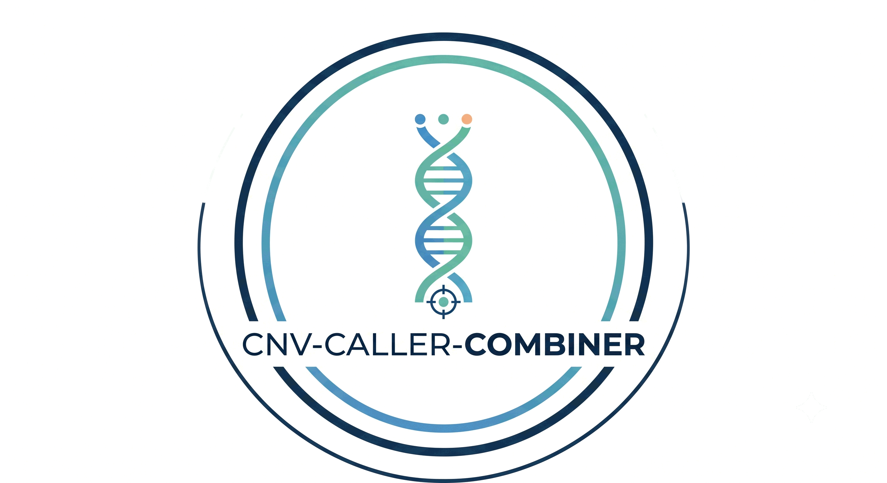

<p align="center">
  
</p>

<h1 align="center">CNV-Caller-Combiner Pipeline</h1>

<p align="center">
  <strong>Nextflow High-Throughput Exome Germline CNV Calling, Consensus Merging, and Clinical Prioritization</strong>
</p>

<p align="center">
  <a href="https://www.nextflow.io/"></a>
  <a href="https://apptainer.org/"></a>
  <a href="https://github.com/Yonatan-Ariel-Wolberg/CNV-Caller-Combiner/blob/main/LICENSE"></a>
  <a href="BEGINNER_GUIDE.md"></a>
  <a href="docs/PARAMETER_ADJUSTMENTS.md"></a>
</p>

The **CNV-Caller-Combiner** is an enterprise-grade, Nextflow DSL2-powered exome sequencing pipeline that integrates **eight complementary germline CNV and structural variant callers**, performs target-aware quality control and sample gating, normalizes caller confidences into standardized Phred-scaled quality scores, resolves multi-caller consensus with nucleotide-level breakpoint refinement, prioritizes true variants using gradient-boosted decision trees (CatBoost / XGBoost), and automates clinical ACMG 2019/2020 diagnostic tiering.

*This pipeline is optimized for exome sequencing cohorts under HPC environments (e.g., the ZA-WITS-CORE SLURM cluster) and cloud platforms (AWS / Illumina Connected Analytics ICAv2).*

---

## 🧬 Beginner's Guide (No Bioinformatics or Coding Experience Required)

*A standalone version of this guide is also available at [BEGINNER_GUIDE.md](file:///home/ywolberg/CNV-Caller-Combiner/BEGINNER_GUIDE.md).*

Welcome! If you are a clinician, researcher, or student with limited bioinformatics or programming experience, this section is written for you. 

The **CNV-Caller-Combiner** automatically discovers **Copy Number Variations (CNVs)**—deletions and duplications of genomic segments—from Whole Exome Sequencing (WES) data.

### 💡 Why Use This Pipeline?

Single CNV callers frequently suffer from high false-positive rates or miss real variants due to PCR bias and uneven capture efficiency:
* **CANOES** & **CLAMMS** excel at read-depth modeling across targeted intervals.
* **XHMM** uses Principal Component Analysis (PCA) to remove systematic cohort noise.
* **CNVkit** models both on-target and off-target read depths.
* **GATK gCNV** applies Bayesian probabilistic models across intervals.
* **ExomeDepth** dynamically selects customized reference cohorts per sample.
* **SvABA** reconstructs structural variant (SV) breakpoints at single-base-pair resolution.

**This pipeline runs these tools together, merges their consensus using geometric overlap, refines the breakpoints, and classifies variants into clinical ACMG Pathogenic tiers—all automatically.**

### 🚀 The 3-Step Quickstart

You do not need to write complex command-line scripts or edit configuration files by hand.

#### Step 1: Open Terminal & Run the Quickstart Launcher
Navigate to the repository folder and execute:
```bash
cd /home/ywolberg/CNV-Caller-Combiner
./launch.sh
```
*Or use non-interactive CLI flags:*
```bash
./launch.sh -i /path/to/bams -o /path/to/results -p balanced --batch
```

#### Step 2: Interactive Wizard or Automated Dispatch
If running interactively, the launcher wizard guides you through:
1. **Workflow Selection**: Choose `local` (default: 6 callers), `cloud` (ICAv2 DRAGEN), `hybrid`, or `evaluate`.
2. **Input alignments folder**: Folder containing `.bam` or `.cram` files (e.g. `/dataG/my_cohort/`).
3. **Results folder**: Where you want your output saved.
4. **Sex Information**: Automatically inferred from chrX / chrY coverage using `bin/make_sexinfo.py` (or provide custom file).
5. **Filtering Profile**:
   * Press `1` for **Balanced** *(Recommended for most studies; F1-score maximized)*.
   * Press `2` for **High Precision** *(Strict thresholds, minimal false positives; ideal if validating with qPCR)*.
   * Press `3` for **Max Sensitivity** *(Relaxed thresholds; ideal for undiagnosed rare diseases)*.
6. **Launch Mode**: Press `1` to submit to the SLURM cluster in the background, or `2` for local foreground.

#### Step 3: Sit Back!
The launcher automatically:
* Scans and verifies your BAMs or CRAMs and their indexes (`.bai` or `.crai`).
* Automatically infers sample chromosomal sex via chrX/chrY coverage.
* Generates your samplesheet and configuration parameter files.
* Executes pre-flight sanity audits on all reference genomes and databases.
* Submits the job to the cluster scheduler (SLURM) and outputs your **Job ID**.

### 🔍 How to Monitor Your Run

Check on your pipeline anytime using these standard commands:
```bash
# Check if your job is running or queued:
squeue -u $USER

# Watch live pipeline output logs:
tail -f /path/to/results/slurm-cnv-local-<JOB_ID>.out
```

### 📊 How to Read Your Results (Without Coding!)

When the pipeline completes, navigate to your results folder to find:

#### 1. The Executive Clinical Summary (`CLINICAL_SUMMARY_REPORT.md`)
Run the summary tool anytime to generate an instant clinical breakdown:
```bash
python3 bin/summarize_results.py --results-dir /path/to/results/balanced
```
It displays:
* Total Pathogenic (`ACMG_5`) and Likely Pathogenic (`ACMG_4`) calls.
* Top recurrent disease genes affected across your cohort.
* Direct paths to tabular files ready for spreadsheet analysis.

#### 2. Opening in Microsoft Excel or Google Sheets
Open the file:
```
consensus_evaluate/*ACMG_4_5.tsv
```
This spreadsheet-ready table contains high-confidence clinical candidates with the following columns:
* **`SampleID`**: The patient / sample identifier.
* **`CHROM`**, **`POS`**, **`END`**: Genomic coordinates (GRCh38).
* **`SVTYPE`**: `DEL` (Deletion) or `DUP` (Duplication).
* **`CALLERS`**: Which callers agreed on this variant (e.g. `CANOES;CLAMMS;XHMM;GCNV`).
* **`NUM_CALLERS`**: Total number of callers supporting the call.
* **`ACMG_CLASS`**: `5` (Pathogenic) or `4` (Likely Pathogenic).
* **`GENES`**: Specific genes overlapped by the CNV.

#### 3. Viewing in IGV (Integrative Genomics Viewer)
To visually inspect reads confirming a deletion or duplication:
1. Open IGV on your computer.
2. Select genome **Human (hg38)**.
3. Load the patient BAM: `/path/to/results/converted_bams/<SampleID>.bam`.
4. Load the consensus VCF: `/path/to/results/consensus_refined/<SampleID>.refined.vcf.gz`.
5. Jump to the coordinate (e.g. `chr7:117,550,000-117,600,000`) to confirm read-depth changes.

#### 4. Interactive Web Report (`multiqc_report.html`)
Open `multiqc_report.html` in any web browser (Chrome, Firefox, Safari) for interactive plots of coverage depth, mapping quality, and caller concordance.

### 🛠️ Built-in Helper Tools for Beginners

| Tool | Command | What It Does |
| :--- | :--- | :--- |
| **Reference Staging Utility** | `./bin/setup_reference_bundle.sh -d ./references` | Automatically downloads and stages CLAMMS, XHMM, and Broad GATK GRCh38 references. |
| **Sex Metadata Inferrer** | `python3 bin/make_sexinfo.py -s samples.tsv -o sexinfo.tsv` | Automatically infers sample biological sex from chrX/chrY coverage. |
| **Samplesheet Maker** | `python3 bin/make_samplesheet.py -i /path/to/bams -o samples.tsv` | Automatically scans any folder, checks for `.bai`/`.crai` indexes, and generates a valid samplesheet. |
| **Pre-Flight Checker** | `python3 bin/validate_run.py -p params.json` | Runs a 10-point audit verifying all reference FASTA files, BEDs, and databases before you start. |
| **Results Summarizer** | `python3 bin/summarize_results.py -r /path/to/results` | Tallies ACMG classes and lists candidate genes in a clean summary table. |

### ❓ Frequently Asked Questions (FAQ)

* **What if some of my BAMs are missing index (`.bai`) files?**  
  Run `samtools index my_sample.bam` to generate the `.bai` index. The samplesheet maker will warn you if any indexes are missing.
* **How long does a run take?**  
  For a cohort of 10–20 exomes: ~1 to 2 hours. For 90–100 exomes: ~4 to 6 hours on the cluster.
* **Can I re-run with a different filtering profile without re-running all callers?**  
  **Yes!** Nextflow's `-resume` feature caches caller outputs. Switching between `-profile balanced`, `-profile high_precision`, or `-profile max_sensitivity` skips the heavy computation and re-filters in minutes.

---

## 🔬 Comprehensive Scientific Workflow Architecture

The **CNV-Caller-Combiner** orchestrates a modular 9-stage analysis architecture that transforms raw exome alignments into clinically prioritized, publication-ready variant callsets:

```
                      Raw BAMs / CRAMs
                             │
                             ▼
  ┌─────────────────────────────────────────────────────────────┐
  │  Stage 1: Target-Aware Quality Control & Sample Gating      │
  │  - Verified CRAM-to-BAM sliced extraction (EOF/integrity)   │
  │  - Dynamic 3- vs 4-column BED handling (samtools bedcov)    │
  │  - Cohort correlation matrix & bimodal outlier gating       │
  │  - Sanger exome calibrated thresholds (75% breadth @ 10x)   │
  │  - Automated biological sex inference & FIPS crypto bypass  │
  └──────────────────────────────┬──────────────────────────────┘
                                 │
                                 ▼
  ┌─────────────────────────────────────────────────────────────┐
  │  Stage 2: Parallel Multi-Caller CNV & SV Discovery          │
  │  - CANOES (Negative Binomial HMM across GC covariates)       │
  │  - CLAMMS (Mappability-aware mixture depth models)          │
  │  - XHMM (PCA SVD technical batch noise elimination)         │
  │  - CNVkit (On-target & off-target antitarget segmentation)  │
  │  - GATK gCNV (Hierarchical Bayesian MCMC interval models)   │
  │  - ExomeDepth (Dynamic reference selection, beta-binomial)  │
  │  - Illumina DRAGEN (Cloud-native ICAv2 FPGA acceleration)   │
  │  - SvABA (Local de novo assembly, single-base breakends)    │
  └──────────────────────────────┬──────────────────────────────┘
                                 │
                                 ▼
  ┌─────────────────────────────────────────────────────────────┐
  │  Stage 3: Normalization & Phred-Scaled Calibration          │
  │  - Harmonize disparate likelihoods/BFs to Phred (0–99)      │
  │  - 3 Calibrated profiles: Balanced, High-Precision, Max-Sens│
  └──────────────────────────────┬──────────────────────────────┘
                                 │
                                 ▼
  ┌─────────────────────────────────────────────────────────────┐
  │  Stage 4: Geometric Consensus Merging                       │
  │  - SURVIVOR & Truvari geometric reciprocal overlap (>=50%)  │
  │  - Provenance tracking: CALLERS and NUM_CALLERS tags        │
  └──────────────────────────────┬──────────────────────────────┘
                                 │
                                 ▼
  ┌─────────────────────────────────────────────────────────────┐
  │  Stage 5: Nucleotide-Resolution Breakpoint Refinement       │
  │  - Size-adaptive window search matching depth calls to SVs  │
  │  - Microhomology & precise coordinate updating via SvABA    │
  └──────────────────────────────┬──────────────────────────────┘
                                 │
                                 ▼
  ┌─────────────────────────────────────────────────────────────┐
  │  Stage 6: ML Feature Extraction & Cohort Database           │
  │  - Extract 20+ features: GC, target density, caller support │
  │  - Mosdepth per-target depth distributions & ratio metrics  │
  └──────────────────────────────┬──────────────────────────────┘
                                 │
                                 ▼
  ┌─────────────────────────────────────────────────────────────┐
  │  Stage 7: Dual-Pathway ML & Internal Allele Frequency Gating│
  │  - Pathway A: Cohort AF <= 5% Filter ──► CatBoost Classifier│
  │  - Pathway B: CatBoost Classifier ──► Cohort AF <= 5% Filter│
  │  - Strictly internal cohort AF (avoids external DB bias)    │
  └──────────────────────────────┬──────────────────────────────┘
                                 │
                                 ▼
  ┌─────────────────────────────────────────────────────────────┐
  │  Stage 8: Clinical ACMG Tiering & Annotation (AnnotSV)      │
  │  - Joint gene-level & full-span dosage sensitivity scoring  │
  │  - ACMG 2019/2020 Classes 1–5 (Pathogenic to Benign)        │
  │  - Stratified callsets: ACMG_4_5, ACMG_5, ACMG_4, ACMG_3    │
  └──────────────────────────────┬──────────────────────────────┘
                                 │
                                 ▼
  ┌─────────────────────────────────────────────────────────────┐
  │  Stage 9: Automated Visualization & Multi-Stage Reporting   │
  │  - Standalone Headless IGV HTML reports per candidate       │
  │  - SeeNV coverage infographics & multi-caller concordances  │
  │  - Executive summary markdown & 6-stage attrition tracking  │
  └─────────────────────────────────────────────────────────────┘
```

---

## 📂 Repository Layout

Below is an overview of the directory structure and the files contained within each:

### 1. Root Workflows & Pipelines
- **[main.nf](file:///home/ywolberg/CNV-Caller-Combiner/main.nf)**: The main entrypoint pipeline for running individual caller workflows (CANOES, CLAMMS, CNVkit, GATK gCNV, ICAv2-DRAGEN, ExomeDepth, SvABA, XHMM).
- **[cnv-caller-combiner.nf](file:///home/ywolberg/CNV-Caller-Combiner/cnv-caller-combiner.nf)**: Orchestrates the core consensus and machine learning combination pipeline. This workflow runs:
  1. Target-aware sample QC and Mosdepth consensus BED generation.
  2. Multi-caller CNV calling and raw output evaluation (`1_raw`).
  3. Quality and size filtering of individual caller callsets (`2_filtered`).
  4. Intra-sample and inter-sample cohort merging via SURVIVOR / Truvari (`3_merged` & `4_inter_merged`).
  5. Nucleotide-resolution breakpoint refinement pairing depth consensus with SvABA assembly breakends.
  6. Machine learning feature extraction, database compilation, and CatBoost / XGBoost ranking paths.
  7. Internal cohort allele frequency filtering (strictly dataset-internal; avoids external database bias).
  8. AnnotSV variant annotation and ACMG classification (Classes 1–5).
- **End-to-End Caller Workflows**:
  - [canoes_germline_cnv_end_to_end.nf](file:///home/ywolberg/CNV-Caller-Combiner/canoes_germline_cnv_end_to_end.nf)
  - [clamms_germline_cnv_end_to_end.nf](file:///home/ywolberg/CNV-Caller-Combiner/clamms_germline_cnv_end_to_end.nf)
  - [cnvkit_germline_cnv_end_to_end.nf](file:///home/ywolberg/CNV-Caller-Combiner/cnvkit_germline_cnv_end_to_end.nf)
  - [dragen_germline_cnv_end_to_end.nf](file:///home/ywolberg/CNV-Caller-Combiner/dragen_germline_cnv_end_to_end.nf)
  - [gcnv_germline_cnv_end_to_end.nf](file:///home/ywolberg/CNV-Caller-Combiner/gcnv_germline_cnv_end_to_end.nf)
  - [xhmm_germline_cnv_end_to_end.nf](file:///home/ywolberg/CNV-Caller-Combiner/xhmm_germline_cnv_end_to_end.nf)
- **Utility Pipelines (`workflows/utilities/`)**:
  - [ddduk-90-control-filter-merge-freq.nf](file:///home/ywolberg/CNV-Caller-Combiner/workflows/utilities/ddduk-90-control-filter-merge-freq.nf): Filter and merge allele frequencies for control panels.
  - [ddduk-90-mosdepth-filter-merge-freq.nf](file:///home/ywolberg/CNV-Caller-Combiner/workflows/utilities/ddduk-90-mosdepth-filter-merge-freq.nf): Mosdepth filter coverage pipeline.
  - [evaluate_score_separated.nf](file:///home/ywolberg/CNV-Caller-Combiner/workflows/utilities/evaluate_score_separated.nf): Score-separated metric evaluator.
  - [icav2_config_set.nf](file:///home/ywolberg/CNV-Caller-Combiner/workflows/utilities/icav2_config_set.nf): ICAv2 configuration helper.

### 2. Subdirectories
- **[bin/](file:///home/ywolberg/CNV-Caller-Combiner/bin/README.md)**: Production executables, R scripts, format converters, and quality metric extractors invoked during workflow steps. See [bin/README.md](file:///home/ywolberg/CNV-Caller-Combiner/bin/README.md).
- **[modules/](file:///home/ywolberg/CNV-Caller-Combiner/modules/README.md)**: Atomic Nextflow DSL2 modules adhering to the Single Responsibility Principle (callers, ML, evaluation, filters, annotation, normalise, sample-qc, sv-mergers). See [modules/README.md](file:///home/ywolberg/CNV-Caller-Combiner/modules/README.md).
- **[containers/](file:///home/ywolberg/CNV-Caller-Combiner/containers/)**: Container build recipes (Dockerfiles, Apptainer/Singularity `.def` definitions).
- **[benchmarks/](file:///home/ywolberg/CNV-Caller-Combiner/benchmarks/README.md)**: Offline model exploration, multi-caller combination benchmarks, and publication visualization scripts. See [benchmarks/README.md](file:///home/ywolberg/CNV-Caller-Combiner/benchmarks/README.md).
- **[scripts/](file:///home/ywolberg/CNV-Caller-Combiner/scripts/README.md)**: Automation and execution helper shell scripts. See [scripts/README.md](file:///home/ywolberg/CNV-Caller-Combiner/scripts/README.md).
- **[params/](file:///home/ywolberg/CNV-Caller-Combiner/params/README.md)**: Configuration parameters in JSON format for the DDD UK and DDD Africa datasets. See [params/README.md](file:///home/ywolberg/CNV-Caller-Combiner/params/README.md).
- **[sbatch/](file:///home/ywolberg/CNV-Caller-Combiner/sbatch/README.md)**: SLURM batch submission scripts tailored for the wits cluster. See [sbatch/README.md](file:///home/ywolberg/CNV-Caller-Combiner/sbatch/README.md).
- **[tests/](file:///home/ywolberg/CNV-Caller-Combiner/tests/README.md)**: Automated unit and integration tests verifying workflows, conversions, and parameter validation. See [tests/README.md](file:///home/ywolberg/CNV-Caller-Combiner/tests/README.md).

---

## 🚀 Getting Started

### Prerequisites
Make sure you have Nextflow (>= 23.04) and Apptainer/Singularity (or Docker) installed on your environment.

### Execution with Generic Parameter Templates
The pipeline includes pre-configured, generic parameter templates in `params/general/`:

```bash
# Run the full multi-caller consensus & ML combiner pipeline
nextflow run cnv-caller-combiner.nf \
  -profile wits_cluster \
  -params-file params/general/params-full.json \
  --workflow full \
  --ml_pathway A \
  -resume
```

### Filtering Profiles
Select between three calibrated quality filtering profiles:
* **Balanced Profile** (`params/general/params-filter-balanced.json`): Recommended for most studies; maximizes F1-score balance between sensitivity and precision.
* **High-Precision Profile** (`params/general/params-filter-high-precision.json`): Stringent thresholds; minimizes false positives, ideal when validating calls via wet-lab qPCR or MLPA.
* **Max-Sensitivity Profile** (`params/general/params-filter-max-sensitivity.json`): Permissive thresholds; minimizes false negatives, ideal for undiagnosed rare disease exploration.

---

## 🤖 Machine Learning Model Training

The pipeline supports training a gradient-boosted classifier (CatBoost by default, or XGBoost) to filter candidate CNVs.

### Truth-label TSV requirements

When training the model via `--workflow train`, a gold-standard ground-truth dataset must be provided via `--truth_labels`. The file must be a tab-separated values (TSV) table containing the following required columns:
- `sample_id`: Identifier of the sample matching candidate feature matrices.
- `chrom`: Chromosome name (e.g. `chr1` or `1`).
- `start`: 1-based start coordinate of the CNV call.
- `end`: End coordinate of the CNV call.
- `cnv_type`: CNV variant type (`DEL` or `DUP`).
- `truth_label`: Binary label indicating true call status (integer: `1` for true positive, `0` for false positive).

Example:
```tsv
sample_id	chrom	start	end	cnv_type	truth_label
SAMPLE_001	chr1	1000000	1050000	DEL	1
SAMPLE_001	chr2	2000000	2050000	DUP	0
```
In the training evaluation, a call with `truth_label = 1` represents a verified true CNV, while `truth_label = 0` denotes a false positive.

---

## 📖 In-Depth Module Documentation

Exhaustive documentation for every caller, merger, and analysis module is available in `docs/modules/`:

| Module | Category | Description | Documentation |
| :--- | :--- | :--- | :--- |
| **CANOES** | Caller | Negative binomial HMM exome CNV caller with GC covariate adjustment | [docs/modules/canoes.md](docs/modules/canoes.md) |
| **CLAMMS** | Caller | Mappability- and GC-modeled exome caller with Picard insert-size metrics | [docs/modules/clamms.md](docs/modules/clamms.md) |
| **XHMM** | Caller | PCA-based SVD matrix normalization and Viterbi HMM genotyper | [docs/modules/xhmm.md](docs/modules/xhmm.md) |
| **CNVkit** | Caller | On-target and off-target antitarget depth modeler with CBS segmentation | [docs/modules/cnvkit.md](docs/modules/cnvkit.md) |
| **GATK gCNV** | Caller | Hierarchical Bayesian MCMC caller over discrete targeted intervals | [docs/modules/gatk-gcnv.md](docs/modules/gatk-gcnv.md) |
| **ExomeDepth** | Caller | Beta-binomial caller with dynamic sample-specific reference selection | [docs/modules/exomedepth.md](docs/modules/exomedepth.md) |
| **DRAGEN (ICAv2)** | Caller | Cloud-accelerated FPGA germline CNV and SV calling via ICAv2 | [docs/modules/dragen.md](docs/modules/dragen.md) |
| **SvABA** | Caller | Split-read and local de novo string-graph assembly for single-base breakends | [docs/modules/svaba.md](docs/modules/svaba.md) |
| **SURVIVOR** | Merger | Multi-VCF union and intersection merging with distance-based clustering | [docs/modules/survivor.md](docs/modules/survivor.md) |
| **Truvari** | Merger | Benchmarking engine and reciprocal overlap collapse for structural variants | [docs/modules/truvari.md](docs/modules/truvari.md) |
| **Breakpoint Refinement** | Refinement | Nucleotide-level coordinate resolution combining depth consensus and SVs | [docs/modules/refinement.md](docs/modules/refinement.md) |
| **Target-Aware QC** | Quality Control | Exome coverage breadth, bimodal cohort correlation, and FIPS container bypass | [docs/modules/target-aware-qc.md](docs/modules/target-aware-qc.md) |
| **Normalization** | Normalization | Harmonizes disparate caller metrics to standardized Phred-scaled scores | [docs/modules/normalise.md](docs/modules/normalise.md) |
| **Feature Extraction** | Machine Learning | Extracts 20+ genomic, coverage, GC, and caller concordance features | [docs/modules/feature-extraction.md](docs/modules/feature-extraction.md) |
| **ML Train & Predict** | Machine Learning | CatBoost and XGBoost gradient boosting classifiers and cross-validation | [docs/modules/train.md](docs/modules/train.md) |
| **Clinical Annotation** | Annotation | AnnotSV integration and ACMG 2019/2020 clinical pathogenicity tiering | [docs/modules/annotation.md](docs/modules/annotation.md) |

### Visualization & Clinical Interpretation Guides
- [How to Interpret Headless IGV HTML Reports](docs/how-to-interpret-igv-html.md)
- [How to Interpret SeeNV CNV Infographics](docs/how-to-interpret-seenv-png.md)


### Sexinfo file requirements
The sexinfo file must be a tab-delimited file containing at least the `sample_id` column and the sex column.
Valid values for sex are `M` (male) and `F` (female).
The sexinfo file does not need to contain exactly the same set of IDs as samplesheet.tsv; extra IDs are ignored, but the sexinfo file must include all sample IDs present in the input samplesheet.

### Known unhandled use-case errors (current gaps)
- `--workflow gcnv`: missing index or invalid intervals.
- `--workflow cnvkit`: invalid antitarget bed.
- `--workflow feature_extraction`: missing collapsed vcf.
- `--workflow train`: invalid label format.
- Any workflow: some workflow-specific secondary assets may exist but still be unreadable or invalid in ways not fully pre-validated.

---

## 🛠️ Software Setup & Configuration Guide (Nextflow & Apptainer/Singularity)

To run **CNV-Caller-Combiner**, you only need two core software prerequisites installed on your host system: **Nextflow** and **Apptainer** (or **Singularity**). All individual bioinformatics tools, caller dependencies, and Python/R environments are automatically managed inside container images.

### 1. System Requirements
- **Operating System**: Linux (x86_64, e.g., Ubuntu 20.04+, Debian 11+, RHEL 8+, Rocky Linux, AlmaLinux) or macOS.
- **Java**: Java 17 or Java 21 (LTS 64-bit).
- **Disk Space**: At least 50 GB free space for Singularity container images and Nextflow scratch work directories.

---

### 2. Installing Nextflow

#### Step A: Install Java 17 or 21
Verify your current Java version:
```bash
java -version
```
If Java is not installed or older than version 17, install it using your package manager:
```bash
# Ubuntu / Debian:
sudo apt update && sudo apt install -y openjdk-21-jre-headless

# RHEL / Rocky Linux / CentOS / Fedora:
sudo dnf install -y java-21-openjdk-headless

# HPC Module Systems (SLURM / Lmod / Environment Modules):
module load java/21 || module load openjdk/21
```

#### Step B: Download and Install Nextflow
```bash
# Download the executable Nextflow binary
curl -s https://get.nextflow.io | bash

# Make it executable and move it to your PATH
chmod +x nextflow
mkdir -p ~/.local/bin
mv nextflow ~/.local/bin/

# Ensure ~/.local/bin is in your PATH (add to ~/.bashrc if needed)
export PATH="$HOME/.local/bin:$PATH"

# Verify installation
nextflow -version
```

#### Step C: Configure Nextflow Environment Variables
Add the following recommended environment variables to your `~/.bashrc` or `~/.bash_profile` to manage cache and scratch space:
```bash
# Where Singularity container images (.sif) will be stored and reused
export NXF_SINGULARITY_CACHEDIR="${HOME}/.singularity/cache"

# Set a dedicated temporary directory with sufficient disk space
export TMPDIR="/tmp/${USER}"
mkdir -p "${NXF_SINGULARITY_CACHEDIR}" "${TMPDIR}"
```

---

### 3. Installing Apptainer / Singularity

Apptainer (formerly Singularity) is the container runtime used by Nextflow to execute pipeline processes in isolated, reproducible scientific environments without requiring root privileges.

#### Option A: Ubuntu / Debian (Package Manager)
```bash
# Install Apptainer via the official PPA
sudo apt update
sudo apt install -y software-properties-common
sudo add-apt-repository -y ppa:apptainer/ppa
sudo apt update
sudo apt install -y apptainer

# Verify installation
apptainer --version
```

#### Option B: RHEL / Rocky Linux / AlmaLinux / CentOS 8+ (EPEL)
```bash
# Enable Extra Packages for Enterprise Linux (EPEL)
sudo dnf install -y epel-release
sudo dnf install -y apptainer

# Verify installation
apptainer --version
```

#### Option C: High-Performance Computing (HPC) Clusters (Environment Modules)
On most shared institutional clusters (such as the ZA-WITS-CORE HPC), Singularity or Apptainer is already installed as an environment module. Simply load it in your session or shell profile:
```bash
module load apptainer || module load singularity
```

#### Option D: Non-Root / User-Space Binary Installation
If you do not have `sudo` access on your machine, you can install the standalone Apptainer binary:
```bash
APPTAINER_VER="1.3.4"
curl -sLO "https://github.com/apptainer/apptainer/releases/download/v${APPTAINER_VER}/apptainer-${APPTAINER_VER}-x86_64.tar.gz"
tar -xzf "apptainer-${APPTAINER_VER}-x86_64.tar.gz"
mkdir -p ~/.local/
cp -r apptainer/* ~/.local/
export PATH="$HOME/.local/bin:$PATH"
apptainer --version
```

---

### 4. Verifying Nextflow + Apptainer Integration

Run this quick single-command smoke test to ensure Nextflow can fetch and execute containers via Apptainer:

```bash
nextflow run hello -with-singularity
```
Expected output:
```text
N E X T F L O W  ~  version 24.10.0
Launching `https://github.com/nextflow-io/hello` [tender_ramanujan] DSL2 - revision: master
executor >  local (4)
[d3/76840d] process > sayHello (4) [100%] 4 of 4 ✔
Bonjour world!
Ciao world!
Hello world!
Hola world!
```

---

## 🤝 Acknowledgments & Citations

The **CNV-Caller-Combiner** pipeline synthesizes and builds upon exceptional open-source software, workflows, and scientific research developed across the global bioinformatics community.

### 🌟 Special Mentions & Foundational Workflows

* **Dr. Phelelani Mpangase** (University of the Witwatersrand / Sydney Brenner Institute for Molecular Bioscience):
  Special mention and gratitude to Dr. Phelelani Mpangase, whose open-source Nextflow exome CNV calling pipeline [**`nf-exomecnv`**](https://github.com/phelelani/nf-exomecnv) provided the architectural foundation, caller integration patterns, and initial Docker recipes upon which the core caller execution modules of **CNV-Caller-Combiner** were developed.
* **Regan Cannell** (Sydney Brenner Institute for Molecular Bioscience, University of the Witwatersrand):
  Special mention to Regan Cannell, whose BAM- and CRAM-input Illumina Connected Analytics (ICAv2) DRAGEN Nextflow workflows in [**`ica-elwazi`**](https://github.com/SBIMB/ica-elwazi/tree/main/nextflow_workflows) established the cloud API integration patterns, storage credential protocols, and execution wrappers that formed the foundation of the [`modules-icav2-dragen.nf`](file:///home/ywolberg/CNV-Caller-Combiner/modules/callers/modules-icav2-dragen.nf) pipeline module.

---

### 📚 Primary Citations for Key Tools Used in This Workflow

When using **CNV-Caller-Combiner** in scientific publications, please cite the original publications and GitHub repositories of the characteristic tools:

| Tool | Category | First Publish Journal Article | Source Repository |
| :--- | :--- | :--- | :--- |
| **Nextflow** | Workflow Engine | Di Tommaso P, Chatzou M, Floden EW, Barja PP, Palumbo E, Notredame C. (2017). *Nextflow enables reproducible computational workflows.* **Nature Biotechnology**, 35(4):316–319. doi:[10.1038/nbt.3820](https://doi.org/10.1038/nbt.3820). | [GitHub](https://github.com/nextflow-io/nextflow) |
| **CANOES** | Read-Depth CNV Caller | Backenroth D, Homsy J, Murillo LR, Shen Y, Chung WK. (2014). *CANOES: detecting rare copy number variants from whole exome sequencing data.* **Nucleic Acids Research**, 42(12):e97. doi:[10.1093/nar/gku345](https://doi.org/10.1093/nar/gku345). | [GitHub](https://github.com/mbackenroth/canoes) |
| **CLAMMS** | Read-Depth CNV Caller | Packer JS, Pellegrino M, Meyer JM, DasGupta A, et al. (2016). *CLAMMS: a scalable algorithm for calling common and rare copy number variants from exome sequencing data.* **Bioinformatics**, 32(1):133–139. doi:[10.1093/bioinformatics/btv562](https://doi.org/10.1093/bioinformatics/btv562). | [GitHub](https://github.com/macarthur-lab/clamms) |
| **XHMM** | PCA/HMM CNV Caller | Fromer M, Moran JL, Chambert K, et al. (2012). *Discovery and statistical genotyping of copy-number variation from whole-exome sequencing depth.* **The American Journal of Human Genetics**, 91(4):597–607. doi:[10.1016/j.ajhg.2012.08.023](https://doi.org/10.1016/j.ajhg.2012.08.023). | [Web](https://atgu.mgh.harvard.edu/xhmm/) |
| **CNVkit** | On/Off-Target Caller | Talevich E, Shain AH, Bostner J, Plummer BC, et al. (2016). *CNVkit: Genome-Wide Copy Number Detection and Visualization from Targeted DNA Sequencing.* **PLOS Computational Biology**, 12(4):e1004873. doi:[10.1371/journal.pcbi.1004873](https://doi.org/10.1371/journal.pcbi.1004873). | [GitHub](https://github.com/etal/cnvkit) |
| **GATK gCNV** | Probabilistic CNV Caller | Poplin R, Ruano-Rubio V, DePristo MA, Fennell TJ, et al. (2018). *Scaling accurate genetic variant discovery to tens of thousands of samples.* **bioRxiv**, 201178. doi:[10.1101/201178](https://doi.org/10.1101/201178). | [GitHub](https://github.com/broadinstitute/gatk) |
| **ExomeDepth** | Beta-Binomial Caller | Plagnol V, Curtis J, Epstein M, et al. (2012). *A robust model for read count data in exome sequencing experiments and implications for copy number variant calling.* **Bioinformatics**, 28(21):2747–2754. doi:[10.1093/bioinformatics/bts526](https://doi.org/10.1093/bioinformatics/bts526). | [CRAN](https://cran.r-project.org/package=ExomeDepth) / [GitHub](https://github.com/vplagnol/ExomeDepth) |
| **Illumina DRAGEN** | Hardware-Accelerated SV/CNV | Miller NA, Farrow EG, Gibson M, et al. (2022). *High-throughput whole-genome and exome sequencing analysis with the Illumina DRAGEN platform.* **Nature Biotechnology**, 40(6):875–882. doi:[10.1038/s41587-021-01158-1](https://doi.org/10.1038/s41587-021-01158-1). | [Web](https://www.illumina.com/products/by-type/informatics-products/basespace-sequence-hub/apps/edico-genome-dragen-bio-it-platform.html) |
| **SvABA** | Split-Read & Assembly SV Caller | Wala JA, Bandopadhayay P, Greenwald NF, et al. (2018). *SvABA: genome-wide detection of structural variants and indels by local assembly.* **Genome Research**, 28(4):581–591. doi:[10.1101/gr.226936.117](https://doi.org/10.1101/gr.226936.117). | [GitHub](https://github.com/walaj/svaba) |
| **SURVIVOR** | Structural Variant Merger | Jeffares DC, Jolly C, Ponger L, et al. (2017). *Transient structural variations have major effects on genomic diversity and environment-specific fitness in fission yeast.* **Nature Communications**, 8:14061. doi:[10.1038/ncomms14061](https://doi.org/10.1038/ncomms14061). | [GitHub](https://github.com/fritzsedlazeck/SURVIVOR) |
| **Truvari** | Benchmark & Overlap Engine | English AM, Menon VK, Gibbs RA, Metcalf GA, Sedlazeck FJ. (2022). *Truvari: refined structural variant comparison and benchmarking.* **Genome Biology**, 23(1):258. doi:[10.1186/s13059-022-02840-6](https://doi.org/10.1186/s13059-022-02840-6). | [GitHub](https://github.com/spiralgenetics/truvari) |
| **AnnotSV** | ACMG Classification & Annotation | Geoffroy V, Herenger Y, Kress A, et al. (2018). *AnnotSV: an integrated tool for structural variations annotation.* **Bioinformatics**, 34(20):3572–3574. doi:[10.1093/bioinformatics/bty304](https://doi.org/10.1093/bioinformatics/bty304). | [GitHub](https://github.com/lgmgeo/AnnotSV) |
| **CatBoost** | Gradient Boosting Classifier | Prokhorenkova L, Gusev G, Vorobev A, Dorogush AV, Gulin A. (2018). *CatBoost: unbiased boosting with categorical features.* **Advances in Neural Information Processing Systems (NeurIPS 2018)**, 31:6638–6648. | [GitHub](https://github.com/catboost/catboost) |
| **XGBoost** | Gradient Boosting Classifier | Chen T, Guestrin C. (2016). *XGBoost: A Scalable Tree Boosting System.* **Proceedings of the 22nd ACM SIGKDD International Conference on Knowledge Discovery and Data Mining (KDD '16)**, 785–794. doi:[10.1145/2939672.2939785](https://doi.org/10.1145/2939672.2939785). | [GitHub](https://github.com/dmlc/xgboost) |
| **Mosdepth** | Fast Depth Calculation | Pedersen BS, Quinlan AR. (2018). *Mosdepth: quick coverage calculation for genomes and exomes.* **Bioinformatics**, 34(5):867–868. doi:[10.1093/bioinformatics/btx699](https://doi.org/10.1093/bioinformatics/btx699). | [GitHub](https://github.com/brentp/mosdepth) |
| **Samtools & Htslib** | High-Throughput Sequence Utilities | Danecek P, Bonfield JK, Liddle J, et al. (2021). *Twelve years of SAMtools and BCFtools.* **GigaScience**, 10(2):giab008. doi:[10.1093/gigascience/giab008](https://doi.org/10.1093/gigascience/giab008). | [GitHub](https://github.com/samtools/samtools) |
| **Bedtools** | Genomic Interval Arithmetic | Quinlan AR, Hall IM. (2010). *BEDTools: a flexible suite of utilities for comparing genomic features.* **Bioinformatics**, 26(6):841–842. doi:[10.1093/bioinformatics/btq033](https://doi.org/10.1093/bioinformatics/btq033). | [GitHub](https://github.com/arq5x/bedtools2) |


