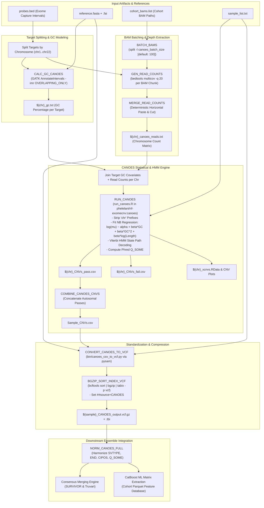
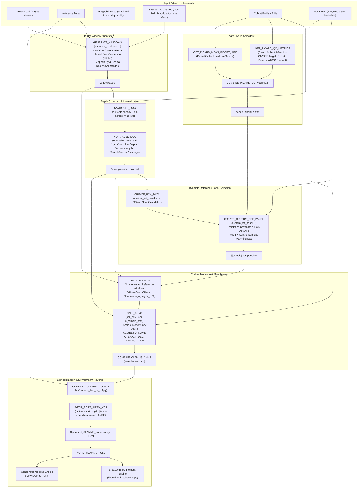
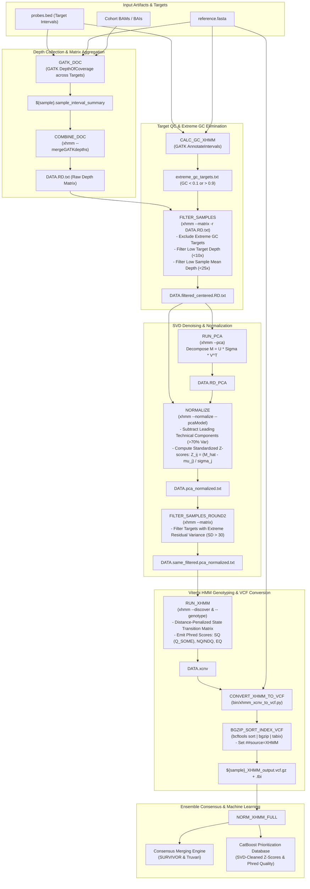
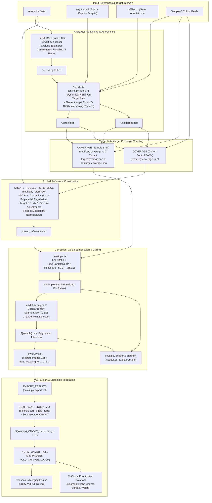
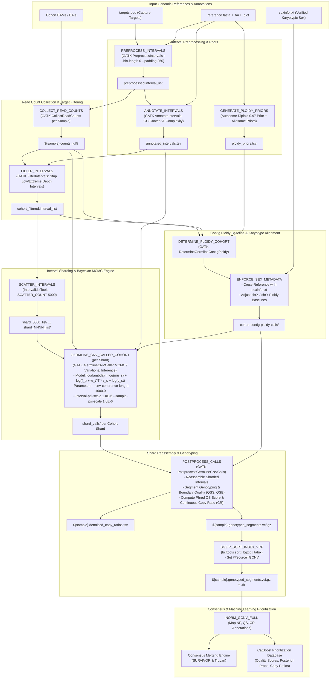
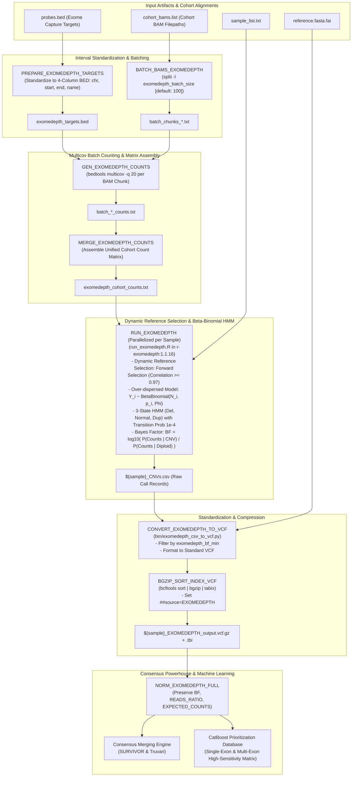
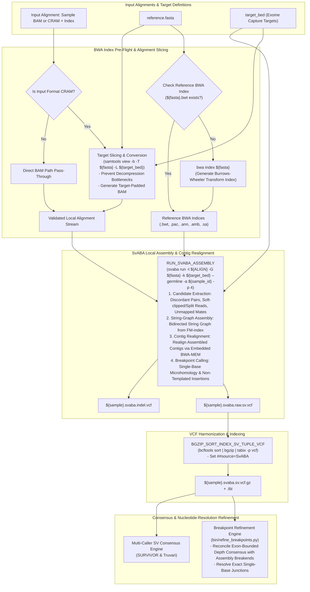
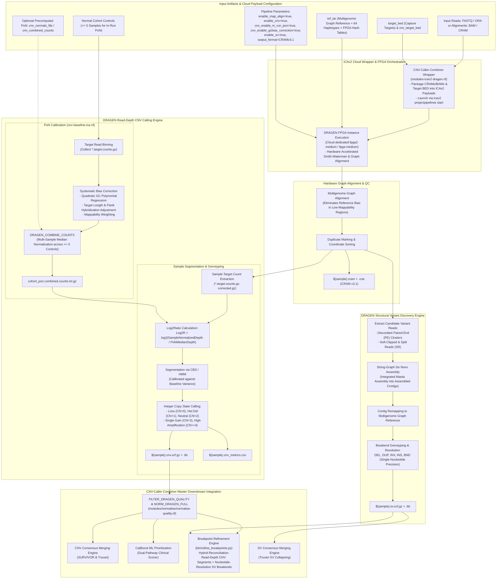

# CNV & SV Caller Workflow Architecture & Specifications

This document provides exhaustive, publication-grade workflow diagrams, algorithmic foundations, container runtime mappings, and Nextflow DSL2 orchestration details for all Copy Number Variant (CNV) and Structural Variant (SV) callers integrated into the `CNV-Caller-Combiner` master ensemble pipeline.

---

## Table of Contents
1. [CANOES: Negative Binomial HMM Exome CNV Caller](#1-canoes-negative-binomial-hmm-exome-cnv-caller)
2. [CLAMMS: Mappability-Aware Mixture-Model Exome CNV Caller](#2-clamms-mappability-aware-mixture-model-exome-cnv-caller)
3. [XHMM: PCA SVD Matrix-Denoising Exome CNV Caller](#3-xhmm-pca-svd-matrix-denoising-exome-cnv-caller)
4. [CNVkit: On-Target & Antitarget Exome Segmentation Caller](#4-cnvkit-on-target--antitarget-exome-segmentation-caller)
5. [GATK-gCNV: Hierarchical Bayesian MCMC Exome CNV Caller](#5-gatk-gcnv-hierarchical-bayesian-mcmc-exome-cnv-caller)
6. [ExomeDepth: Beta-Binomial Exome CNV Caller](#6-exomedepth-beta-binomial-exome-cnv-caller)
7. [SvABA: Local De Novo Assembly Structural Variant Caller](#7-svaba-local-de-novo-assembly-structural-variant-caller)
8. [DRAGEN Germline Enrichment v4.4.6: Combined CNV & SV Caller](#8-dragen-germline-enrichment-v446-combined-cnv--sv-caller)
9. [Comparative Architectural & Statistical Summary Matrix](#9-comparative-architectural--statistical-summary-matrix)

---

## 1. CANOES: Negative Binomial HMM Exome CNV Caller

- **Primary Module**: [`modules/callers/canoes.nf`](file:///home/ywolberg/CNV-Caller-Combiner/modules/callers/canoes.nf)
- **Operational Guide**: [CANOES Skill](file:///home/ywolberg/CNV-Caller-Combiner/.agents/skills/canoes/SKILL.md)
- **Publication**: Backenroth et al., *Nucleic Acids Res.* (2014) [PMID: 24771342](https://pubmed.ncbi.nlm.nih.gov/24771342/)
- **Statistical Model**: Negative Binomial Generalized Linear Model with GC, $\text{GC}^2$, and target length covariate regression; Viterbi HMM decoding.

---

## 2. CLAMMS: Mappability-Aware Mixture-Model Exome CNV Caller

- **Primary Module**: [`modules/callers/clamms.nf`](file:///home/ywolberg/CNV-Caller-Combiner/modules/callers/clamms.nf)
- **Operational Guide**: [CLAMMS Skill](file:///home/ywolberg/CNV-Caller-Combiner/.agents/skills/clamms/SKILL.md)
- **Publication**: Packer et al., *Bioinformatics* (2016) [PMID: 26382196](https://pubmed.ncbi.nlm.nih.gov/26382196/)
- **Statistical Model**: Dynamic sample-specific reference panel selection (PCA + Picard HS QC distance); Gaussian mixture models on mappability-adjusted coverage windows; sex-aware allosomal genotyping.

---

## 3. XHMM: PCA SVD Matrix-Denoising Exome CNV Caller

- **Primary Module**: [`modules/callers/xhmm.nf`](file:///home/ywolberg/CNV-Caller-Combiner/modules/callers/xhmm.nf)
- **Operational Guide**: [XHMM Skill](file:///home/ywolberg/CNV-Caller-Combiner/.agents/skills/xhmm/SKILL.md)
- **Publication**: Fromer et al., *Am. J. Hum. Genet.* (2012) [PMID: 23040492](https://pubmed.ncbi.nlm.nih.gov/23040492/)
- **Statistical Model**: Singular Value Decomposition (SVD) Principal Component Analysis to subtract batch/plate noise; distance-weighted Viterbi HMM decoding on target z-scores.

---

## 4. CNVkit: On-Target & Antitarget Exome Segmentation Caller

- **Primary Module**: [`modules/callers/cnvkit.nf`](file:///home/ywolberg/CNV-Caller-Combiner/modules/callers/cnvkit.nf)
- **Operational Guide**: [CNVkit Skill](file:///home/ywolberg/CNV-Caller-Combiner/.agents/skills/cnvkit/SKILL.md)
- **Publication**: Talevich et al., *PLoS Comput. Biol.* (2016) [PMID: 27100738](https://pubmed.ncbi.nlm.nih.gov/27100738/)
- **Statistical Model**: On-target and off-target (antitarget) binning; GC, length, and repeat bias regression; Circular Binary Segmentation (CBS); discrete copy number mapping.

---

## 5. GATK-gCNV: Hierarchical Bayesian MCMC Exome CNV Caller

- **Primary Module**: [`modules/callers/gatk-gcnv.nf`](file:///home/ywolberg/CNV-Caller-Combiner/modules/callers/gatk-gcnv.nf)
- **Operational Guide**: [GATK-gCNV Skill](file:///home/ywolberg/CNV-Caller-Combiner/.agents/skills/gatk-gcnv/SKILL.md)
- **Publication**: Babadi et al., *Nat. Genet.* (2023) [PMID: 37723223](https://pubmed.ncbi.nlm.nih.gov/37723223/)
- **Statistical Model**: Hierarchical Bayesian probabilistic graphical model; MCMC and variational inference modeling global depth, interval capture efficiency, latent bias projections, and copy ratio; contig ploidy priors; interval sharding.

---

## 6. ExomeDepth: Beta-Binomial Exome CNV Caller

- **Primary Module**: [`modules/callers/exomedepth.nf`](file:///home/ywolberg/CNV-Caller-Combiner/modules/callers/exomedepth.nf)
- **Operational Guide**: [ExomeDepth Skill](file:///home/ywolberg/CNV-Caller-Combiner/.agents/skills/exomedepth/SKILL.md)
- **Publication**: Plagnol et al., *Bioinformatics* (2012) [PMID: 22942019](https://pubmed.ncbi.nlm.nih.gov/22942019/)
- **Statistical Model**: Dynamic sample-specific reference panel selection (correlation $\ge 0.97$); over-dispersed Beta-Binomial read count distribution; 3-state HMM with transition penalty; Bayes Factor (BF) variant quantification.

---

## 7. SvABA: Local De Novo Assembly Structural Variant Caller

- **Primary Module**: [`modules/callers/svaba.nf`](file:///home/ywolberg/CNV-Caller-Combiner/modules/callers/svaba.nf)
- **Operational Guide**: [SvABA Skill](file:///home/ywolberg/CNV-Caller-Combiner/.agents/skills/svaba/SKILL.md)
- **Publication**: Wala et al., *Genome Res.* (2018) [PMID: 29535149](https://pubmed.ncbi.nlm.nih.gov/29535149/)
- **Algorithmic Model**: Target-restricted candidate read extraction (split reads, discordant pairs); localized de novo assembly via bidirected string graph (FM-index/BWT); contig realignment via BWA-MEM; base-pair resolution breakpoint calling.

---

## 8. DRAGEN Germline Enrichment v4.4.6: Combined CNV & SV Caller

- **Primary Module**: [`modules/callers/modules-icav2-dragen.nf`](file:///home/ywolberg/CNV-Caller-Combiner/modules/callers/modules-icav2-dragen.nf)
- **Operational Guide**: [DRAGEN Germline Enrichment v4.4.6 Skill](file:///home/ywolberg/CNV-Caller-Combiner/.agents/skills/dragen-germline-enrichment-v4-4-6/SKILL.md)
- **Foundational Publication**: Behera et al., *Nature Biotechnology* (2025) [DOI: 10.1038/s41587-024-02382-1](https://doi.org/10.1038/s41587-024-02382-1)
- **Architecture**: Unified hardware-accelerated FPGA pipeline integrating multigenome graph mapping, in-run Panel of Normals (PoN) read-depth CNV calling, and Manta split-read/string-graph SV assembly.

---

## 9. Comparative Architectural & Statistical Summary Matrix

| Tool | Category | Statistical Foundation | Primary Covariates & Normalization | Container Runtime | Output VCF Name Pattern | Downstream Role |
| :--- | :--- | :--- | :--- | :--- | :--- | :--- |
| **CANOES** | Exome CNV | Negative Binomial Generalized Linear Model + Viterbi HMM | GC, $\text{GC}^2$, target exon length, library size | `phelelani/nf-exomecnv:canoes` | `${sample}_CANOES_output.vcf.gz` | High specificity in medium cohorts ($N=100\text{--}500$); CatBoost feature contributor. |
| **CLAMMS** | Exome CNV | Dynamic PCA reference selection + Gaussian Mixture Models | Mappability tracks, Picard HS metrics (fold-80, AT/GC drop), sex | `phelelani/nf-exomecnv:clamms` | `${sample}_CLAMMS_output.vcf.gz` | Mappability-aware calling; allosomal sex-calibrated genotyping. |
| **XHMM** | Exome CNV | Singular Value Decomposition (SVD) PCA + Distance HMM | Target mean depth, extreme GC exclusion ($<0.1$ or $>0.9$), PCA variance subtraction | `phelelani/nf-exomecnv:xhmm` | `${sample}_XHMM_output.vcf.gz` | Removes technical batch and sequencing plate artifacts. |
| **CNVkit** | Exome & Genome CNV | Circular Binary Segmentation (CBS) on On/Off-target bins | Dynamic autobin sizing, refFlat annotations, pooled reference normalization | `biocontainers/cnvkit:0.9.12` | `${sample}_CNVKIT_output.vcf.gz` | Broad multi-exon and whole-gene CNVs; antitarget off-probe resolution. |
| **GATK-gCNV** | Germline Exome CNV | Hierarchical Bayesian Graphical Model (MCMC / Variational Inference) | GC waves, probe length, latent sample bias loadings, contig ploidy priors | `broadinstitute/gatk:4.6.2.0` | `${sample}.genotyped_segments.vcf.gz` | Gold-standard statistical authority; complex and allosomal loci. |
| **ExomeDepth** | Exome CNV | Over-dispersed Beta-Binomial Distribution + 3-state HMM | Step-wise sample correlation forward selection ($\ge 0.97$), Bayes Factor | `quay.io/biocontainers/r-exomedepth:1.1.16` | `${sample}_EXOMEDEPTH_output.vcf.gz` | Highest sensitivity for single-exon deletions and duplications. |
| **SvABA** | Structural Variant (SV) | Local de novo String-Graph Assembly (FM-index/BWT) + BWA-MEM | Target capture restriction (`-k`), candidate read filtering, assembly contigs | `quay.io/biocontainers/svaba:1.2.0` | `${sample}.svaba.sv.vcf.gz` | Primary provider of single-nucleotide breakpoint coordinates for refinement. |
| **DRAGEN v4.4.6** | Combined CNV & SV | Hardware FPGA Multigenome Graph + Median PoN CBS/HMM + Manta Assembly | Graph alignment, quadratic GC correction, target length, median PoN, PE/SR clusters | Dedicated ICAv2 Cloud FPGA (`fpga2-medium`) | `${sample}.cnv.vcf.gz` & `${sample}.sv.vcf.gz` | Hardware-accelerated rapid caller; dual read-depth and split-read engine. |
