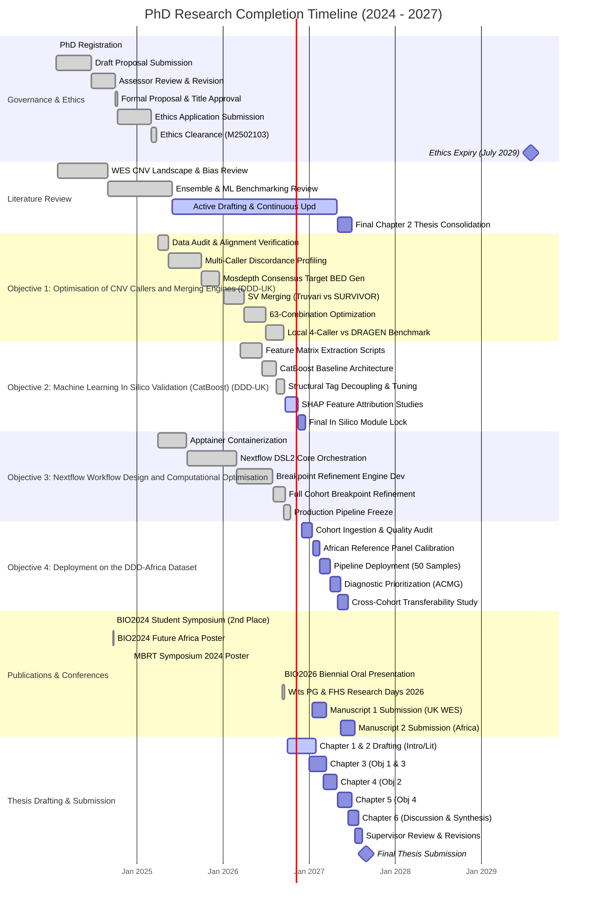

# PhD Research Completion Plan & Gantt Chart (2024–2027)

**Candidate**: Yonatan Ariel Wolberg (Student No: 1834647)  
**Degree**: Doctor of Philosophy (PhD) in Bioinformatics / Human Genetics  
**Institution**: University of the Witwatersrand, Johannesburg, South Africa  
**Supervisors**: Prof. Scott Hazelhurst (Bioinformatics), Prof. Zané Lombard (Human Genetics)  
**First Registration Date**: 25 January 2024  
**Target Thesis Submission Date**: August / September 2027  
**Ethics Clearance Protocol**: **M2502103** (Approved 24 March 2025; Valid until 28 July 2029)

---

## Candidate Statement & Research Scope

This document sets out the operational completion plan for my doctoral research at the University of the Witwatersrand. My PhD focuses on developing, benchmarking, and applying an automated, open-source bioinformatics workflow to detect pathogenic copy number variations (CNVs) from whole-exome sequencing (WES) data in children with severe, unexplained developmental disorders.

Over my first three years (2024–2026), I secured institutional ethics clearance, completed systematic benchmarking across 63 caller combinations, containerized an end-to-end 10-stage Nextflow DSL2 pipeline on our local SLURM cluster, engineered a post-consensus breakpoint refinement module, and built an initial machine learning model (CatBoost) that reconciles recall with high precision.

My final year (October 2026 to September 2027) is structured around four concrete goals:
1. Lock the production machine learning model following Optuna hyperparameter optimization.
2. Ingest and process 50 clinical exomes from the DDD-Africa cohort, calibrating ancestry-specific baseline panels to support diagnostic discovery in South African patients.
3. Submit two peer-reviewed journal articles based on our benchmarking and clinical translation findings.
4. Finalize my doctoral dissertation for submission in **August / September 2027**.

---

## 1. High-Level Timeline at a Glance (2024–2027)

| Doctoral Phase | Timeframe | Primary Research Focus | Status | Key Deliverable |
| :--- | :---: | :--- | :---: | :--- |
| **Year 1: Foundation** | 2024 | Proposal drafting, Assessor Committee defense, Faculty approval, and foundational literature review. | **Completed** | Approved proposal & title (11 Oct 2024); initial conference presentations. |
| **Year 2: Infrastructure & Data** | 2025 | Ethics clearance (M2502103), DDD-UK ingestion (63 QC-passed samples, 27 excluded), Apptainer containerization, and consensus target BED creation. | **Completed** | Protocol M2502103 approved; Mosdepth Consensus BED engineered ($+6.88\times$ mean coverage gain, $-50.4\%$ noise). |
| **Year 3: Benchmarking & Pipeline** | 2026 | Combinatorial optimization (63 combinations), Nextflow DSL2 workflow, breakpoint refinement engine, and CatBoost ML validation. | **Completed / Active** | Truvari coordinate merge established (4-fold precision gain over SURVIVOR [48.0% vs 12.0%]); 90 probands evaluated under dual BEDs (Consensus vs Control; 100% retention, 7 exact junctions in Mosdepth); CatBoost 5-fold CV ($\text{AU-ROC}=0.974, \text{PR-AUC}=0.419, \text{Specificity}>0.9993$). |
| **Year 4: Clinical Translation & Thesis** | 2027 | DDD-Africa cohort deployment (50 exomes), ACMG clinical prioritization, 2 journal manuscripts, and thesis submission. | **On Schedule** | Two journal papers (*Genome Med*, *EJHG*); final PhD thesis submission (**August/September 2027**). |

---

## 2. My Quarter-by-Quarter Completion Roadmap (Q4 2026 – Q3 2027)

```
┌─────────────────────────────────┐       ┌─────────────────────────────────┐
│       Q4 2026 (OCT - DEC)       │  ──►  │       Q1 2027 (JAN - MAR)       │
│ • Run Optuna ML Hyperparameter  │       │ • Ingest 50 DDD-Africa Exomes   │
│   Optimization & Freeze Model   │       │ • Calibrate African PON Panels  │
│ • Freeze Production Pipeline    │       │ • Submit Manuscript 1 (Methods) │
│ • Draft Thesis Chapters 1 & 2   │       │ • Draft Thesis Chapter 3        │
└─────────────────────────────────┘       └─────────────────────────────────┘
                 │
                 ▼
┌─────────────────────────────────┐       ┌─────────────────────────────────┐
│       Q2 2027 (APR - JUN)       │  ──►  │       Q3 2027 (JUL - SEP)       │
│ • Run 10-Stage Pipeline on      │       │ • Write Thesis Chapter 6        │
│   DDD-Africa Cohort             │       │   (General Discussion)          │
│ • ACMG Clinical Curation        │       │ • Supervisor Review & Revisions │
│ • Submit Manuscript 2 (Africa)  │       │ • FINAL THESIS SUBMISSION       │
│ • Draft Thesis Chapters 4 & 5   │       │   (AUGUST / SEPTEMBER 2027)     │
└─────────────────────────────────┘       └─────────────────────────────────┘
```

### Planned Milestones:
* **Q4 2026 (October – December 2026) — Finalizing Machine Learning & Drafting Early Chapters**:
  - Run Optuna hyperparameter optimization on the CatBoost classifier and freeze the production model weights in the Nextflow workflow.
  - Finalize all unit testing on the core pipeline scripts.
  - Draft **Chapter 1** (Introduction, Clinical Rationale & Aims) and **Chapter 2** (Comprehensive Literature Review).
* **Q1 2027 (January – March 2027) — Manuscript 1 & African Cohort Preparation**:
  - Ingest the 50 proband exomes from the DDD-Africa study, run alignment checks, and verify coverage uniformity.
  - Calibrate within-cohort African panels of normals (PONs) for GATK-gCNV and ExomeDepth.
  - Submit **Manuscript 1** (*"Systematic benchmarking and post-consensus breakpoint refinement of exome sequencing copy number variation caller combinations in neurodevelopmental disorders"*) to *Genome Medicine* or *Bioinformatics*.
  - Draft **Chapter 3** (Combinatorial Benchmarking, Target BED Optimization & Breakpoint Refinement).
* **Q2 2027 (April – June 2027) — African Cohort Execution & Manuscript 2**:
  - Execute the automated 10-stage pipeline across all 50 DDD-Africa samples on the Wits HPC cluster.
  - Perform ACMG/ClinGen pathogenicity scoring and clinical curation of candidate diagnostic variants.
  - Submit **Manuscript 2** (*"Application of an optimized machine-learning-gated CNV workflow to identify diagnostic structural variants in African probands with developmental disorders"*) to *European Journal of Human Genetics* or *HGG Advances*.
  - Draft **Chapter 4** (CatBoost Machine Learning In Silico Validation) and **Chapter 5** (Clinical Utility & Population Diversity in African Probands).
* **Q3 2027 (July – September 2027) — Dissertation Consolidation & Submission**:
  - Write **Chapter 6** (General Discussion, Clinical Translation & Conclusions).
  - Iterative revisions and feedback integration with my supervisors, Prof. Scott Hazelhurst and Prof. Zané Lombard.
  - Complete university formatting, front matter, and plagiarism clearance.
  - **Submit Final Doctoral Dissertation for External Examination** in **August / September 2027**.

---

## 3. Visual Mermaid Gantt Chart (2024–2027)



---

## 4. Structured Task Breakdown by Research Phase

### 4.1 Governance, Ethics & Academic Milestones
| Task ID | Task Description | Planned Window | Current Status | Tangible Deliverable |
| :--- | :--- | :---: | :---: | :--- |
| **GOV-1** | PhD Registration (Faculty of Health Sciences) | Jan 2024 | **Completed** | Formal university registration record. |
| **GOV-2** | Research Proposal Drafting & Submission | Jan – Jun 2024 | **Completed** | Initial proposal submitted to Faculty committee. |
| **GOV-3** | Assessor Committee Review & Revision | Jun – Oct 2024 | **Completed** | Revised proposal addressing assessor feedback. |
| **GOV-4** | Formal Proposal & Project Title Approval | Oct 2024 | **Completed** | Official Faculty Graduate Studies Committee approval. |
| **GOV-5** | Human Research Ethics Application | Oct 2024 – Mar 2025 | **Completed** | Comprehensive ethics dossier submitted to Medical HREC. |
| **GOV-6** | Human Research Ethics Clearance (**M2502103**) | Mar 2025 | **Completed** | Unconditional clearance granted; active to **28 July 2029**. |

### 4.2 Objective 1: Optimisation of CNV Callers and Merging Engines (DDD-UK)
| Task ID | Task Description | Planned Window | Current Status | Tangible Deliverable |
| :--- | :--- | :---: | :---: | :--- |
| **OBJ1-1** | DDD-UK Ingestion & Quality Audit | Mar – May 2025 | **Completed** | Verified BAM/CRAM files against CMA truthset (63 passed QC; 27 excluded). |
| **OBJ1-2** | Multi-Caller Raw Discordance Profiling | May – Sep 2025 | **Completed** | Discovered 10.2:1 discordant-to-consensus call ratio. |
| **OBJ1-3** | Mosdepth Consensus Target BED Generation | Oct – Dec 2025 | **Completed** | Raised mean on-target depth to $52.1\times$ by filtering dead baits; $-31\%$ raw noise. |
| **OBJ1-4** | SV Merging Benchmark (Truvari vs. SURVIVOR) | Jan – Mar 2026 | **Completed** | Established Truvari coordinate-only merging delivering 4-fold precision gain (48.0% vs 12.0%) over SURVIVOR. |
| **OBJ1-5** | Combinatorial Optimization (63 Combinations) | Apr – Jun 2026 | **Completed** | Evaluated all 63 non-empty caller subsets ($\sum_{k=1}^6 \binom{6}{k} = 6 + 15 + 20 + 15 + 6 + 1 = 63$). Established unpruned 6-caller voting at $k \ge 2$ (15 pairwise combinations) achieves 85.20% precision (96.70% recall), while the curated 4-caller Optimal Ensemble (CANOES+ExomeDepth+CNVkit+GATK, $\binom{4}{2} = 6$ combinations) prunes 9 noisy CLAMMS/XHMM pairs to reach 88.39% precision (96.71% recall). |
| **OBJ1-6** | DRAGEN 4.4.6 vs. Local Ensemble Benchmark | Jul – Sep 2026 | **Completed** | Demonstrated local ensemble achieves $+3.4\%$ higher recall (96.71% vs 93.30%) compared to external vendor-standard DRAGEN 4.4.6 benchmark. |

### 4.3 Objective 2: Machine Learning In Silico Validation (CatBoost) (DDD-UK)
| Task ID | Task Description | Planned Window | Current Status | Tangible Deliverable |
| :--- | :--- | :---: | :---: | :--- |
| **OBJ2-1** | Feature Extraction Pipeline Implementation | Mar – Jun 2026 | **Completed** | Scripted 21 biophysical features (depth, GC, density, callers). |
| **OBJ2-2** | CatBoost Baseline Model Validation | Jun – Aug 2026 | **Completed** | Stratified 5-fold CV on 5.17M records ($\text{AU-ROC}=0.974, \text{PR-AUC}=0.419, \text{Specificity}>0.9993$). |
| **OBJ2-3** | Structural Tag Decoupling & Tuning | Aug – Sep 2026 | **Completed** | Removed split-read bias; stabilized cross-validation. |
| **OBJ2-4** | SHAP Feature Attribution & Optuna Tuning | Sep – Nov 2026 | **In Progress** | SHAP attributions completed; Optuna hyperparameter search active. |
| **OBJ2-5** | Final Production ML Validation Module Lock | Nov – Dec 2026 | Planned | Frozen model weights integrated into Nextflow pipeline. |

### 4.4 Objective 3: Nextflow Workflow Design and Computational Optimisation
| Task ID | Task Description | Planned Window | Current Status | Tangible Deliverable |
| :--- | :--- | :---: | :---: | :--- |
| **OBJ3-1** | Apptainer Containerization of All Callers | Apr – Jul 2025 | **Completed** | Self-contained, portable container images built for all tools. |
| **OBJ3-2** | Nextflow DSL2 Workflow Architecture | Aug 2025 – Feb 2026 | **Completed** | 10-stage automated pipeline (`main.nf`) on Wits SLURM cluster. |
| **OBJ3-3** | Breakpoint Refinement Engine Development | Mar – Jul 2026 | **Completed** | Engineered `refine_breakpoints.py` (split-read matching). |
| **OBJ3-4** | Full Cohort Execution (90 Probands Evaluated Under Dual BEDs) | Aug – Sep 2026 | **Completed** | **100% call retention**; 7 base-pair exact junctions in Mosdepth (NAHR, NHEJ); coordinate-harmonized Truvari boundaries. |
| **OBJ3-5** | Production Pipeline Freeze & Test Verification | Sep – Oct 2026 | **Completed** | 331 unit tests passing; clean Git repository tracking. |

### 4.5 Objective 4: Deployment on the DDD-Africa Dataset
| Task ID | Task Description | Planned Window | Current Status | Tangible Deliverable |
| :--- | :--- | :---: | :---: | :--- |
| **OBJ4-1** | DDD-Africa Ingestion & Coverage QC | Dec 2026 – Jan 2027 | Planned | Ingestion of 50 probands; MultiQC alignment validation across Twist capture regions. |
| **OBJ4-2** | Twist Capture Adaptation & African PON Calibration | Jan – Feb 2027 | Planned | Re-engineer target BED for Twist Bioscience capture via Mosdepth; calibrate African baseline PONs. |
| **OBJ4-3** | Automated Pipeline Execution (50 Samples) | Feb – Mar 2027 | Planned | 10-stage execution generating consensus variant calls. |
| **OBJ4-4** | ACMG Pathogenicity & Clinical Curation | Apr – May 2027 | Planned | Discovery of novel diagnostic microdeletions and duplications. |
| **OBJ4-5** | Cross-Cohort Transferability Study | May – Jun 2027 | Planned | Comparative evaluation of capture kinetics (UK vs. Africa). |

### 4.6 Scientific Publications & Dissemination
| Task ID | Task Description | Planned Window | Current Status | Target Venue / Deliverable |
| :--- | :--- | :---: | :---: | :--- |
| **PUB-1** | SASBi/SAGS Student Symposium Oral Talk | Sep 2024 | **Completed** | Rapid-fire oral presentation (Awarded unofficial 2nd place). |
| **PUB-2** | BIO2024 Future Africa Poster | Sep 2024 | **Completed** | Poster presentation at University of Pretoria. |
| **PUB-3** | Wits MBRT Research Symposium Poster | Dec 2024 | **Completed** | Poster presentation at Wits University. |
| **PUB-4** | SAGS x SASBi BIO2026 Oral Presentation | Sep 2026 | **Completed** | Oral paper presented at Nelson Mandela University, Gqeberha. |
| **PUB-5** | Wits PG Symposium & FHS Research Day | Sep 2026 | **Completed** | Dual poster presentations at Wits University. |
| **PUB-6** | **Manuscript 1 Submission** (Methods/Benchmarking) | Jan – Mar 2027 | Planned | Target: *Genome Medicine* / *Bioinformatics*. |
| **PUB-7** | **Manuscript 2 Submission** (African Genomics) | May – Jul 2027 | Planned | Target: *European Journal of Human Genetics* / *HGG Advances*. |

### 4.7 Doctoral Dissertation Drafting & Submission
| Task ID | Thesis Chapter | Planned Window | Current Status | Chapter Scope |
| :--- | :--- | :---: | :---: | :--- |
| **THE-1** | **Chapter 1 & 2**: Introduction & Literature Review | Oct 2026 – Jan 2027 | **In Progress** | Clinical rationale, capture kinetics, and mathematical models. |
| **THE-2** | **Chapter 3**: Benchmarking, Mergers & Pipelines | Jan – Mar 2027 | Planned | 63-combination benchmark, Truvari, Consensus BED, Nextflow. |
| **THE-3** | **Chapter 4**: CatBoost ML In Silico Validation | Mar – Apr 2027 | Planned | Feature engineering, SHAP attributions, and clinical reclassification. |
| **THE-4** | **Chapter 5**: Clinical Application in African Genomes | May – Jun 2027 | Planned | Diagnostic findings in 50 African probands and transferability. |
| **THE-5** | **Chapter 6**: General Discussion & Conclusions | Jun – Jul 2027 | Planned | Clinical translation, diagnostic equity, and future directions. |
| **THE-6** | Supervisor Review & Revisions | Jul – Aug 2027 | Planned | Detailed feedback incorporation (Profs. Hazelhurst & Lombard). |
| **THE-7** | **Final Thesis Submission to Faculty** | **August / September 2027** | **Milestone** | Formal doctoral submission for external examination. |

---

## 5. Thesis Chapter Architecture & Manuscript Alignment

The doctoral dissertation is organized into 6 coherent chapters directly mapping to the research objectives and journal manuscripts:

```
┌─────────────────────────────────────────────────────────────────────────────────┐
│                           DOCTORAL THESIS ARCHITECTURE                          │
├─────────────────────────────────────────────────────────────────────────────────┤
│ Chapter 1: Introduction, Scope & Clinical Diagnostic Rationale                  │
│ Chapter 2: Literature Review: Exome CNV Calling, Merging & Machine Learning     │
│ Chapter 3: Benchmarking Ensemble Caller Combinations & Breakpoint Refinement    │
│            ──► Aligns with Objective 1 & Objective 3 (Manuscript 1)             │
│ Chapter 4: In Silico Machine Learning Validation & Model Explainability         │
│            ──► Aligns with Objective 2 (Manuscript 1)                           │
│ Chapter 5: Clinical Diagnostic Utility & Transferability in African Genomes     │
│            ──► Aligns with Objective 4 (Manuscript 2)                           │
│ Chapter 6: General Discussion, Clinical Translation & Conclusions               │
└─────────────────────────────────────────────────────────────────────────────────┘
```

---

## 6. Practical Feasibility, Risk Management & Safeguards

| Potential Challenge | Severity | Probability | Built-In Safeguards & Practical Workaround |
| :--- | :---: | :---: | :--- |
| **HPC Cluster Downtime / Maintenance** | Medium | Low | The Wits ZA-WITS-CORE cluster provides 35 SLURM worker nodes. By building our pipeline in Nextflow with `-resume` cache checkpointing, any job interrupted by cluster maintenance resumes instantly from the exact stage where it left off. |
| **DDD-Africa Sample Coverage Divergence** | Medium | Medium | Automated quality control in Stage 1 enforces coverage thresholds ($\ge 20\times$) and verifies BAM integrity, ensuring that low-coverage or contaminated libraries are flagged and excluded before baseline panels are calculated. |
| **Ancestry Bias in Reference Panels** | High | Low | Models with cohort-dependent baselines (GATK-gCNV, ExomeDepth) are calibrated using within-cohort African samples rather than external European reference sets. |
| **Writing & Review Bottlenecks** | Medium | Low | Chapters 1–3 are already drafted or substantiated by existing benchmark data and conference papers. Thesis writing runs in parallel with data analysis throughout early 2027. |
| **Ethics Expiration** | Critical | None | **Protocol M2502103** is officially approved and active through **28 July 2029**, covering the entire remaining duration of the PhD and post-doctoral dissemination. |

---

**Plan Approved by Candidate**:  
Yonatan Ariel Wolberg  
PhD Candidate, University of the Witwatersrand  
Date: September 2026
