# CNV-Caller-Combiner: Master End-to-End Pipeline Workflow Architecture

This diagram illustrates the simplified, overall architectural flow of the complete `CNV-Caller-Combiner` pipeline from raw sequencing alignments (CRAM/BAM) to actionable ACMG Pathogenic CNVs and diagnostic performance evaluation.

```mermaid
flowchart TD
    subgraph Inputs ["Input Genomic Data & Target Designs"]
        RAW_ALIGN["Input Sequencing Alignments
(CRAM or BAM Files)"]
        CAPTURE_BEDS["Exome Target Capture Beds
(Agilent, Twist, Illumina)"]
        GENOME_REF["Reference Genome FASTA
(GRCh38 / hg38)"]
    end

    subgraph P1 ["Phase 1: Alignment Forensic Verification & Slicing"]
        RAW_ALIGN --> CONV["40-Gate Forensic CRAM-to-BAM Conversion
or Target-Padded Exome Slicing (+250bp)"]
        GENOME_REF --> CONV
        CAPTURE_BEDS --> CONV
        CONV --> QC_BAMS["Certified Analysis BAMs + BAIs"]
    end

    subgraph P2 ["Phase 2: Cohort QC & Consensus Target BED Generation"]
        QC_BAMS --> SAMPLE_QC["Target-Aware Sample QC
(Coverage Depth, Breadth >= 10x, Karyotypic Sex)"]
        CAPTURE_BEDS --> CONS_BED["Multi-Vendor Target BED Consensus
(probes.bed)"]
        SAMPLE_QC --> COHORT_GATE{"Cohort Quality Filter Gate
(Depth >= 30x, Breadth >= 75%)"}
        COHORT_GATE --> CLEAN_COHORT["Clean Cohort Manifest
+ sexinfo.txt"]
    end

    subgraph P3 ["Phase 3: Multi-Caller Discovery & Quality Normalization"]
        CLEAN_COHORT --> CALLERS["Parallel CNV & SV Discovery
- Local CNV: CANOES, CLAMMS, XHMM, CNVkit, GATK-gCNV, ExomeDepth
- Local SV: SvABA
- Cloud (ICAv2): DRAGEN CNV + DRAGEN SV"]
        CONS_BED --> CALLERS
        CALLERS --> FILT_NORM["Quality Filtering & Normalization
- Caller-Specific Phred Score Thresholding
- Normalization to Unified Metric: Q_NORM in [0, 999]"]
        FILT_NORM --> NORM_VCFS["Standardized Candidate Callsets"]
    end

    subgraph P4 ["Phase 4: Consensus Merging & Dual Breakpoint Refinement"]
        NORM_VCFS --> INTRA_MERGE["Intra-Sample Inter-Tool Merging
(SURVIVOR or Truvari, Overlap >= 50%)"]
        INTRA_MERGE --> REFINE{"Dual Breakpoint Refinement Engine
(bin/refine_breakpoints.py)"}
        REFINE -- "Local Branch" --> REF_LOCAL["Reconcile Depth Consensus
with SvABA Contig Breakends"]
        REFINE -- "Cloud Branch" --> REF_CLOUD["Reconcile DRAGEN CNV Segments
with DRAGEN Manta SV Breakends"]
        REF_LOCAL --> COHORT_MERGE["Cohort Inter-Sample Merging
(SURVIVOR / Truvari)"]
        REF_CLOUD --> COHORT_MERGE
        COHORT_MERGE --> COHORT_SV["Unified Cohort Structural Variation Callset"]
    end

    subgraph P5 ["Phase 5: Internal Allele Frequency Filtering"]
        COHORT_SV --> AF_ENGINE["Cohort-Internal Allele Frequency Engine
(AF_internal = AC / AN, Ancestry-Agnostic)"]
        AF_ENGINE --> AF_SPLIT{"Frequency Threshold
(AF < 1.0%)"}
        AF_SPLIT -- "AF >= 1%" --> COMMON_BENIGN["Common Structural Polymorphisms
(Benign Baseline)"]
        AF_SPLIT -- "AF < 1%" --> RARE_CNVS["Rare Structural Variants
(Potential Pathogenic Sub-Cohort)"]
    end

    subgraph P6 ["Phase 6: Machine Learning Feature Extraction & Prioritization"]
        RARE_CNVS --> FEAT_EXTRACT["Multidimensional Feature Extraction (20+ Metrics)
Biophysical, Tool Concordance, Probe-Level L2R"]
        FEAT_EXTRACT --> FEAT_DB["Cohort Feature Parquet Database"]
        FEAT_DB --> CATBOOST["CatBoost Gradient-Boosted Classifier
(GroupKFold CV, SHAP Values, ROC/PR Curves, NRI/IDI)"]
        CATBOOST --> ML_PRIORITIZED["ML-Prioritized Candidate CNVs
(P_pathogenic >= 0.70)"]
    end

    subgraph P7 ["Phase 7: Clinical Variant Annotation & ACMG Tiering"]
        ML_PRIORITIZED --> ANNOTSV["Automated AnnotSV Annotation
(ClinVar, ClinGen, Decipher, OMIM, gnomAD SV)"]
        ANNOTSV --> ACMG_ENGINE["ACMG / ClinGen 2019 Guidelines Tiering
(Classes 1 to 5)"]
        ACMG_ENGINE --> ACMG_FILTER{"Clinical Actionability Filter
(ACMG Class 4 or 5)"}
        ACMG_FILTER --> ACTIONABLE_CNVS["Actionable Diagnostic Variants
(Pathogenic & Likely Pathogenic)"]
    end

    subgraph P8_P9 ["Phases 8 & 9: Diagnostic Evaluation & Funnel Analytics"]
        ACTIONABLE_CNVS --> PERF_EVAL["Diagnostic Performance Evaluation
(Recall, Precision, F2-Score, MCC, FPR, FNR)"]
        ACTIONABLE_CNVS --> FUNNEL_EVAL["Multi-Stage Variant Attrition Funnel
(Raw -> Filtered -> Consensus -> Rare -> ML -> ACMG 4/5)"]
        PERF_EVAL --> FINAL_OUTPUTS["Final Diagnostic Deliverables
- Executive Clinical ACMG Reports
- Publication Figures (ROC, DCA, Attrition Plot)
- Benchmarked Diagnostic Callsets"]
        FUNNEL_EVAL --> FINAL_OUTPUTS
    end
```

