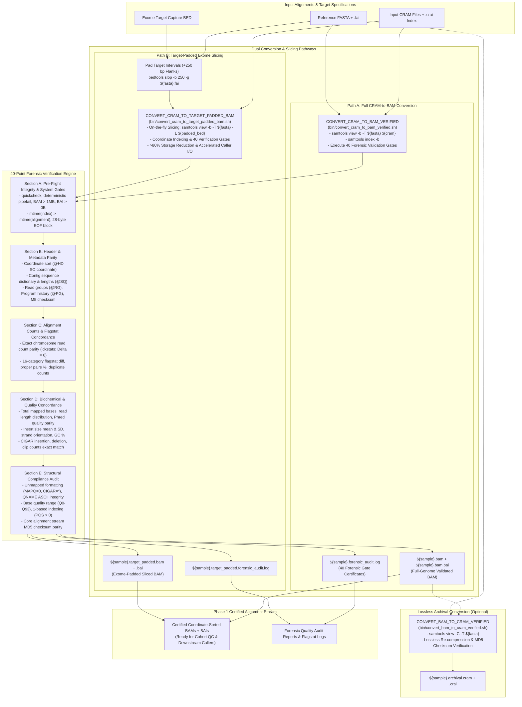
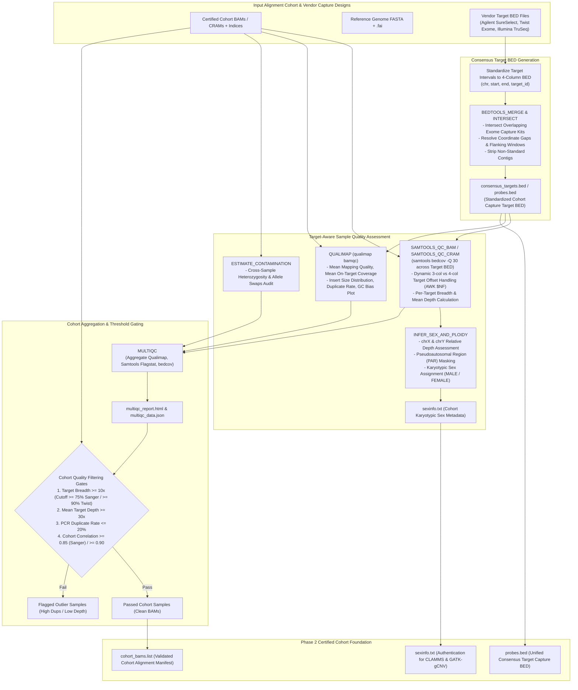
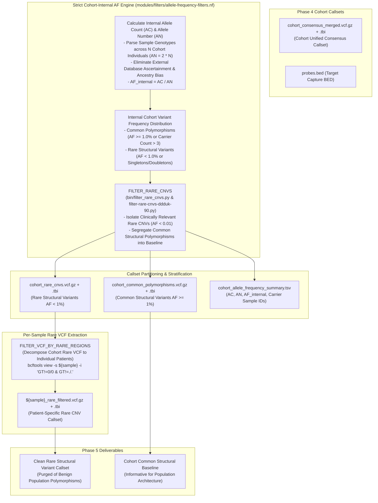
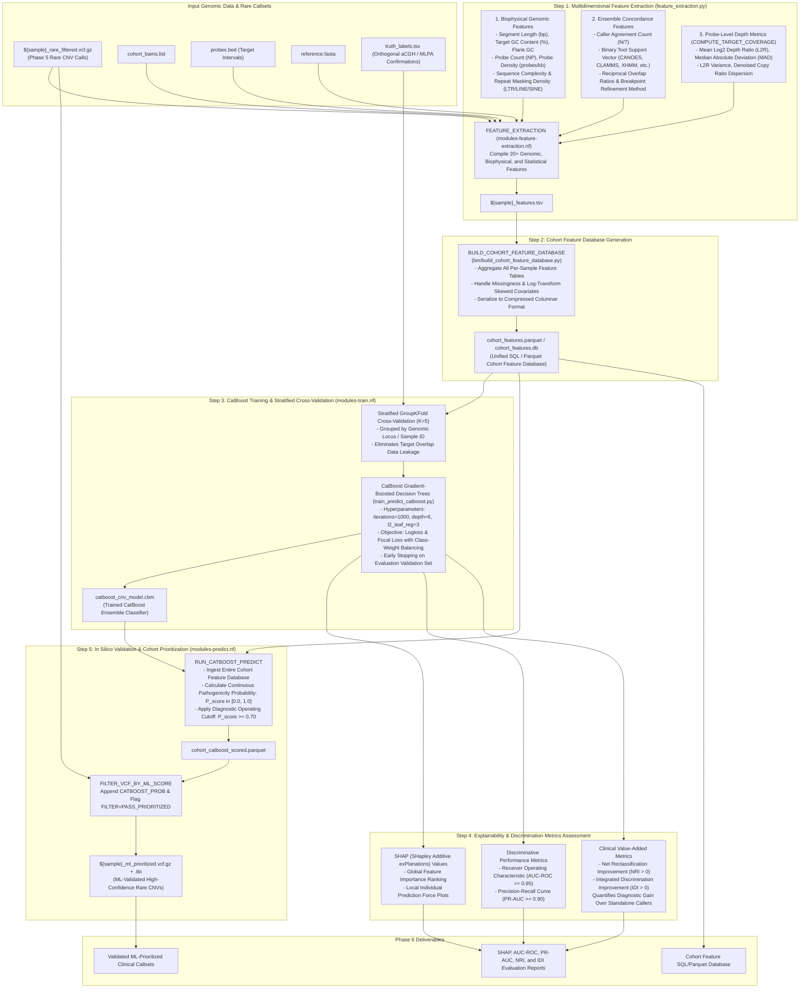
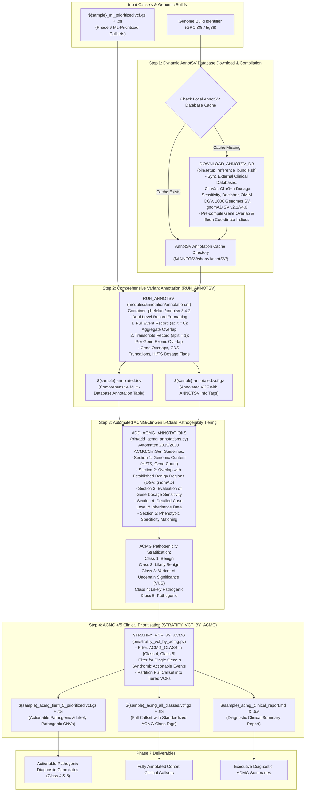
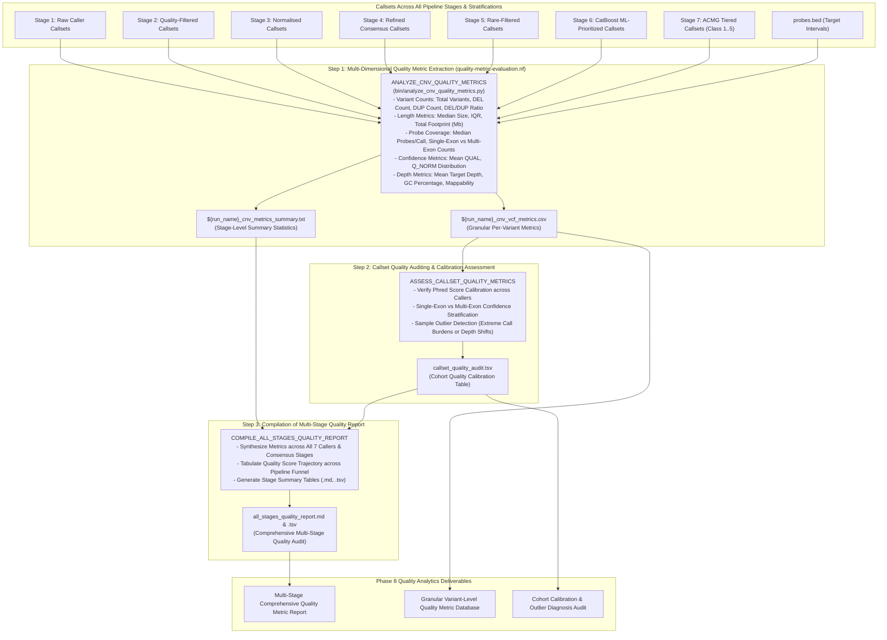
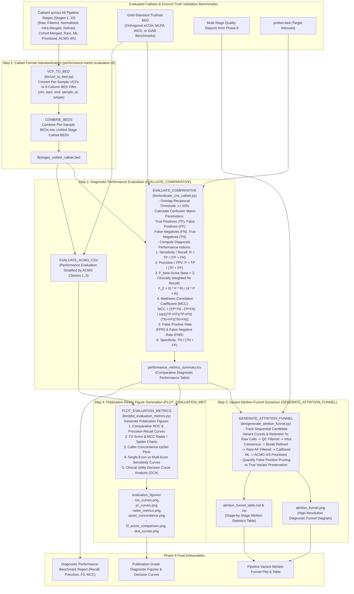

# CNV-Caller-Combiner: 9-Phase Workflow Architecture & Detailed Diagrams

This document provides exhaustive, publication-grade Mermaid.js workflow diagrams and operational specifications for all 9 sequential phases of the `CNV-Caller-Combiner` master exome pipeline.

---

## Phase 1: CRAM to BAM Conversion & Target-Padded Slicing

---

## Phase 2: Cohort QC and Consensus Target BED Generation

---

## Phase 3: High-Level Parallel Calling, Quality Score Filtering and Normalisation

```mermaid
flowchart TD
    subgraph Inputs ["Phase 2 Certified Cohort Inputs"]
        COHORT_BAMS["cohort_bams.list (Passed Cohort BAMs)"]
        PROBES["probes.bed (Consensus Target BED)"]
        REF["reference.fasta"]
        SEX["sexinfo.txt (Karyotypic Sex Metadata)"]
    end

    subgraph HighLevel_Calling ["Parallel CNV & SV Caller Execution (High-Level)"]
        subgraph Local_CNV_Lane ["Local Multi-Caller Read-Depth CNV Lane"]
            CALL_CANOES["RUN_CANOES
(Negative Binomial HMM)"]
            CALL_CLAMMS["RUN_CLAMMS
(PCA Mixture Model)"]
            CALL_XHMM["RUN_XHMM
(SVD PCA Denoising)"]
            CALL_CNVKIT["RUN_CNVKIT
(On/Off-Target CBS)"]
            CALL_GCNV["RUN_GCNV
(Hierarchical Bayesian MCMC)"]
            CALL_EXOMEDEPTH["RUN_EXOMEDEPTH
(Beta-Binomial Forward Selection)"]
        end

        subgraph Local_SV_Lane ["Local Assembly SV Lane"]
            CALL_SVABA["RUN_SVABA
(Local String-Graph De Novo Assembly)"]
        end

        subgraph Cloud_Lane ["Cloud FPGA Unified Enrichment Lane (ICAv2)"]
            CALL_DRAGEN["RUN_DRAGEN_GERMLINE_ENRICHMENT
(Hardware FPGA Multigenome Graph Execution)
- Emits DRAGEN CNV Calls (*.cnv.vcf.gz)
- Emits DRAGEN SV Calls (*.sv.vcf.gz)"]
        end
    end

    subgraph Raw_Callsets ["Raw Candidate Variant Callsets"]
        RAW_CANOES["${sample}_CANOES_raw.vcf.gz"]
        RAW_CLAMMS["${sample}_CLAMMS_raw.vcf.gz"]
        RAW_XHMM["${sample}_XHMM_raw.vcf.gz"]
        RAW_CNVKIT["${sample}_CNVKIT_raw.vcf.gz"]
        RAW_GCNV["${sample}_GCNV_raw.vcf.gz"]
        RAW_EXOMEDEPTH["${sample}_EXOMEDEPTH_raw.vcf.gz"]
        RAW_SVABA["${sample}_SvABA_raw.sv.vcf.gz"]
        RAW_DRAGEN_CNV["${sample}_DRAGEN_raw.cnv.vcf.gz"]
        RAW_DRAGEN_SV["${sample}_DRAGEN_raw.sv.vcf.gz"]
    end

    COHORT_BAMS --> HighLevel_Calling
    PROBES --> HighLevel_Calling
    REF --> HighLevel_Calling
    SEX --> HighLevel_Calling

    CALL_CANOES --> RAW_CANOES
    CALL_CLAMMS --> RAW_CLAMMS
    CALL_XHMM --> RAW_XHMM
    CALL_CNVKIT --> RAW_CNVKIT
    CALL_GCNV --> RAW_GCNV
    CALL_EXOMEDEPTH --> RAW_EXOMEDEPTH
    CALL_SVABA --> RAW_SVABA
    CALL_DRAGEN --> RAW_DRAGEN_CNV
    CALL_DRAGEN --> RAW_DRAGEN_SV

    subgraph Quality_Filtering ["Stage 2: Strict Quality Score Filtering (quality-filters.nf)"]
        FILT_CANOES["FILTER_CANOES_QUALITY
(Q_SOME >= 80, Length >= 1000bp)"]
        FILT_CLAMMS["FILTER_CLAMMS_QUALITY
(Q_SOME >= 100, Q_EXACT_DEL >= 0.5, Q_EXACT_DUP >= -0.2)"]
        FILT_XHMM["FILTER_XHMM_QUALITY
(SQ >= 60, NDQ >= 60, EQ >= 60, Length >= 1000bp)"]
        FILT_CNVKIT["FILTER_CNVKIT_QUALITY
(Probes >= 5, Length >= 10000bp, GQ >= 1)"]
        FILT_GCNV["FILTER_GCNV_QUALITY
(QS_DEL >= 400, QS_DUP >= 400, Single_Interval_QS >= 1000)"]
        FILT_ED["FILTER_EXOMEDEPTH_QUALITY
(Bayes Factor >= 30.0, Length >= 1000bp)"]
        FILT_DRAGEN_CNV["FILTER_DRAGEN_QUALITY
(QUAL >= 10, FILTER == PASS)"]
        FILT_SVABA["FILTER_SVABA_QUALITY
(QUAL >= 30, Contig Realignment MapQ >= 20)"]
        FILT_DRAGEN_SV["FILTER_DRAGEN_SV_QUALITY
(QUAL >= 15, Read Support >= 5)"]

        RAW_CANOES --> FILT_CANOES
        RAW_CLAMMS --> FILT_CLAMMS
        RAW_XHMM --> FILT_XHMM
        RAW_CNVKIT --> FILT_CNVKIT
        RAW_GCNV --> FILT_GCNV
        RAW_EXOMEDEPTH --> FILT_ED
        RAW_DRAGEN_CNV --> FILT_DRAGEN_CNV
        RAW_SVABA --> FILT_SVABA
        RAW_DRAGEN_SV --> FILT_DRAGEN_SV
    end

    subgraph Normalisation ["Stage 3: Unified Quality Normalisation (normalise-quality.nf)"]
        NORM_CANOES["NORM_CANOES_FULL"]
        NORM_CLAMMS["NORM_CLAMMS_FULL"]
        NORM_XHMM["NORM_XHMM_FULL"]
        NORM_CNVKIT["NORM_CNVKIT_FULL"]
        NORM_GCNV["NORM_GCNV_FULL"]
        NORM_ED["NORM_EXOMEDEPTH_FULL"]
        NORM_DRAGEN_CNV["NORM_DRAGEN_FULL"]
        
        HARMONIZE["normalise_cnv_caller_quality_scores.py
- Transform Raw Tool Scores to Unified Phred Confidence: Q_NORM in [0, 999]
- Standardize SVTYPE (DEL, DUP), SVLEN, END Coordinates
- Standardize CIPOS & CIEND Confidence Intervals"]
        
        FILT_CANOES --> NORM_CANOES
        FILT_CLAMMS --> NORM_CLAMMS
        FILT_XHMM --> NORM_XHMM
        FILT_CNVKIT --> NORM_CNVKIT
        FILT_GCNV --> NORM_GCNV
        FILT_ED --> NORM_ED
        FILT_DRAGEN_CNV --> NORM_DRAGEN_CNV

        NORM_CANOES --> HARMONIZE
        NORM_CLAMMS --> HARMONIZE
        NORM_XHMM --> HARMONIZE
        NORM_CNVKIT --> HARMONIZE
        NORM_GCNV --> HARMONIZE
        NORM_ED --> HARMONIZE
        NORM_DRAGEN_CNV --> HARMONIZE
    end

    subgraph Phase3_Outputs ["Phase 3 Standardized Callsets"]
        NORM_CNV_VCFS["${sample}_${caller}_normalised.vcf.gz + .tbi
(Standardized Exome CNV Callsets)"]
        QUAL_SV_VCFS["${sample}_${sv_caller}_filtered.sv.vcf.gz + .tbi
(High-Confidence SV Breakends: SvABA & DRAGEN SV)"]
    end

    HARMONIZE --> NORM_CNV_VCFS
    FILT_SVABA --> QUAL_SV_VCFS
    FILT_DRAGEN_SV --> QUAL_SV_VCFS
```

---

## Phase 4: Intra-Sample Merging, Dual-Pathway Breakpoint Resolution, and Cohort Merging

```mermaid
flowchart TD
    subgraph Inputs ["Standardized Callsets from Phase 3"]
        NORM_CNVS["Normalised CNV Callsets per Sample
(CANOES, CLAMMS, XHMM, CNVkit, GATK-gCNV, ExomeDepth, DRAGEN CNV)"]
        QUAL_SVS["Filtered SV Assembly Callsets per Sample
(SvABA & DRAGEN SV)"]
        REF["reference.fasta"]
        PROBES["probes.bed"]
    end

    subgraph Step1_Intra_Merge ["Step 1: Intra-Sample Inter-Tool Merging (SURVIVOR or Truvari)"]
        MERGE_TOOL{"Select Ensemble Merger Engine
(SURVIVOR or Truvari)"}
        
        SURV_INTRA["SURVIVOR (Intra-Sample Mode)
- Reciprocal Overlap: >= 50%
- Boundary Proximity: <= 1000 bp
- Strandedness & SVTYPE Parity
- Agreement Support: >= 2 Callers"]
        TRUV_INTRA["TRUVARI (Intra-Sample Mode)
- pctsize >= 0.70, pctovl >= 0.50
- Intra-Sample Collapsing to Benchmark Union/Intersection"]
        
        INTRA_CNV["${sample}_intra_consensus.vcf.gz + .tbi
(Intra-Sample Exon-Bounded Read-Depth Consensus)"]
        
        NORM_CNVS --> MERGE_TOOL
        MERGE_TOOL -- SURVIVOR --> SURV_INTRA
        MERGE_TOOL -- Truvari --> TRUV_INTRA
        SURV_INTRA --> INTRA_CNV
        TRUV_INTRA --> INTRA_CNV
    end

    subgraph Step2_Breakpoint_Refine ["Step 2: Dual-Pathway Breakpoint Resolution Engine (bin/refine_breakpoints.py)"]
        ROUTE_PATH{"Select Execution Architecture:
Local vs Cloud-Based"}
        
        subgraph Local_Refine_Lane ["Local Architecture Pathway"]
            LOCAL_DEPTH["Local Consensus CNV Callset
(CANOES + CLAMMS + XHMM + CNVkit + GATK-gCNV + ExomeDepth)"]
            LOCAL_SV["Local SV Assembly Breakends
(SvABA Local String-Graph Contigs)"]
            REFINE_LOCAL["REFINE_BREAKPOINTS (Local Mode)
- Intersect Exon-Bounded Depth Intervals with SvABA Microhomology
- Reconcile Coarse Boundaries (+-100..500bp) to Exact Nucleotide Junctions
- Set CIPOS=(0,0) & Append REFINE_METHOD=SVABA_ASSEMBLY"]
            LOCAL_REFINED_VCF["${sample}_local_refined.vcf.gz"]
            
            LOCAL_DEPTH --> REFINE_LOCAL
            LOCAL_SV --> REFINE_LOCAL
            REFINE_LOCAL --> LOCAL_REFINED_VCF
        end

        subgraph Cloud_Refine_Lane ["Cloud-Based Architecture Pathway"]
            CLOUD_DEPTH["Cloud DRAGEN CNV Callset
(DRAGEN Germline Enrichment CNV Caller)"]
            CLOUD_SV["Cloud DRAGEN SV Callset
(DRAGEN Germline Enrichment SV Caller)"]
            REFINE_CLOUD["REFINE_BREAKPOINTS (Cloud Mode)
- Intersect DRAGEN Depth Segments with DRAGEN Manta Assembly Breakends
- Single-Base Junction Resolution at Breakpoint Junctions
- Append REFINE_METHOD=DRAGEN_MANTA"]
            CLOUD_REFINED_VCF["${sample}_cloud_refined.vcf.gz"]
            
            CLOUD_DEPTH --> REFINE_CLOUD
            CLOUD_SV --> REFINE_CLOUD
            REFINE_CLOUD --> CLOUD_REFINED_VCF
        end

        INTRA_CNV --> ROUTE_PATH
        QUAL_SVS --> ROUTE_PATH
        ROUTE_PATH -- Local Callers --> Local_Refine_Lane
        ROUTE_PATH -- Cloud ICAv2 Callers --> Cloud_Refine_Lane
        
        REFINED_SAMPLE_VCF["${sample}_refined_consensus.vcf.gz + .tbi
(Base-Pair Resolution Intra-Sample Consensus)"]
        LOCAL_REFINED_VCF --> REFINED_SAMPLE_VCF
        CLOUD_REFINED_VCF --> REFINED_SAMPLE_VCF
    end

    subgraph Step3_Cohort_Merge ["Step 3: Cohort Inter-Sample Merging (SURVIVOR or Truvari)"]
        COHORT_MERGE_TOOL{"Select Inter-Sample Merger
(SURVIVOR or Truvari)"}
        
        SURV_COHORT["MERGE_CONSENSUS_COHORT (SURVIVOR)
- Combine All Cohort Refined Sample VCFs
- Parameterize: max_distance=1000bp, min_support=1
- Preserve Caller Provenance & Tool Mask Strings"]
        TRUV_COHORT["MERGE_CONSENSUS_COHORT (Truvari)
- Truvari Collapse across Cohort
- Multi-Sample Site Clustering & Genotype Harmonization"]
        
        POST_PROCESS["Consensus Postprocessing (consensus-postprocess.nf)
- SANITIZE_COHORT_VCF
- BCFTOOLS_FLATTEN_COHORT (Generate Per-Sample Genotype Columns)"]
        
        COHORT_VCF["cohort_consensus_merged.vcf.gz + .tbi
(Unified Cohort Structural Variation Callset)"]
        
        REFINED_SAMPLE_VCF --> COHORT_MERGE_TOOL
        COHORT_MERGE_TOOL -- SURVIVOR --> SURV_COHORT
        COHORT_MERGE_TOOL -- Truvari --> TRUV_COHORT
        SURV_COHORT --> POST_PROCESS
        TRUV_COHORT --> POST_PROCESS
        POST_PROCESS --> COHORT_VCF
    end

    subgraph Phase4_Outputs ["Phase 4 Deliverables"]
        INTRA_DELIV["Sample-Level Refined Consensus Calls"]
        COHORT_DELIV["Cohort-Level Unified Consensus Callset
(Ready for Internal AF & Machine Learning)"]
    end

    REFINED_SAMPLE_VCF --> INTRA_DELIV
    COHORT_VCF --> COHORT_DELIV
```

---

## Phase 5: Internal Allele Frequency Filtering

---

## Phase 6: Feature Extraction, CatBoost ML Training, Explainability, and In Silico Validation

---

## Phase 7: AnnotSV Annotation and ACMG 4/5 Clinical Prioritisation

---

## Phase 8: Quality Score Metric Extraction and Analysis

---

## Phase 9: Performance Metric Evaluation, Figure Generation, and Attrition Funnel

---

